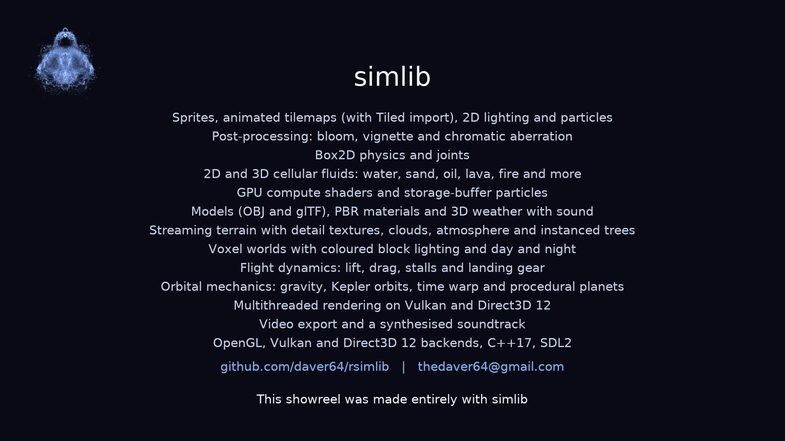

# simlib

[](https://www.youtube.com/watch?v=D1dyvnGUUNw)

**[Watch the showreel](https://www.youtube.com/watch?v=D1dyvnGUUNw)**: a three-minute tour of simlib, rendered entirely by simlib itself.

`simlib` is an easy-to-use, feature-rich C++ multimedia and rendering framework for 2D and 3D applications, with an Allegro 4-style API built on SDL2 and selectable OpenGL, Vulkan and Direct3D 12 backends.

It combines immediate-mode 2D drawing and automatic batching with a powerful 3D rendering system, including meshes, materials, terrain, voxel worlds, lighting, normal mapping, post-processing and GPU compute. Beyond graphics, simlib provides integrated audio, video playback, physics, fluid simulation, procedural generation and Lua scripting — giving you the building blocks to create games, visual simulations and interactive applications in one library.

## Start here

simlib comes with a short [Tutorial](docs/tutorial/README.md) (13 lessons across 2D, 3D and simulation) and a gallery of runnable examples with a page each in the [Example Gallery](docs/examples/README.md). Pick the route below that matches what you are building.

| I want to... | Run | Read |
|--------------|-----|------|
| Make a 2D game (sprites, input, sound) | `exhello`, `ex2dfeatures`, `exroguelike` | [Core API](docs/api_reference.md), [Tile Maps](#tile-maps--tiled-import) |
| Build a 3D app or scene | `ex3d_surface`, `exmodel3d`, `exvoxel` | [3D Graphics](#3d-graphics-surfaces-models--voxel-worlds), [3D Surfaces](docs/api_reference.md#3d-surfaces-includesurface3dh) |
| Simulate something (flight, fluids, physics, weather) | `exflight`, `exorbit`, `exfluid3d`, `exprecip3d` | [Flight](docs/flight.md), [Terrain](docs/terrain.md), [World Flavour](docs/world_flavour.md) |
| Go deep on rendering (shaders, compute, effects) | `exshader`, `excompute`, `expostprocess`, `exlighting` | [Renderer Backends](docs/renderers.md), [Graphics Effects](docs/graphics_effects.md) |
| Script it or add tools | `exlua`, `exluaconsole`, `exgui` | [Lua Scripting](docs/scripting_lua.md) |

**Multithreaded rendering.** The Vulkan and Direct3D 12 backends record large batches of 3D mesh draws on worker threads automatically, with identical output and no code changes (OpenGL ignores it). In our benchmark of 2,000 to 50,000 draws on Vulkan, frame time fell by roughly 28-34%; small scenes are unaffected. Direct3D 12 uses the same design but has not yet been benchmarked. For the heaviest scenes, `sl::RenderQueue3D` lets your own worker threads build draws as well. Learn more in the [tutorial lesson](docs/tutorial/3d-04-many-objects-and-threads.md), the [`exparallel`](docs/examples/exparallel.md) example, the [3D Surfaces API](docs/api_reference.md#3d-surfaces-includesurface3dh) and [Parallel command recording](docs/renderers.md#parallel-command-recording).

**Backend status.** OpenGL and Vulkan are built and tested on Linux (the `ctest` suite includes pixel-level 3D blending checks that run on both). Direct3D 12 implements the same API but is Windows-only and is not covered by the Linux test runs, so treat it as less proven until you have run the suite on your own hardware. Use `ex3d_surface --gl`, `--vulkan` or `--d3d12` to compare backends. While developing, `sl::draw_frame_stats()` shows FPS and per-frame 3D draw counts.

## Quick start

A minimal application only needs `sl.h`, which pulls in the whole public API:

```cpp
#include "sl.h"

int main()
{
    if (!sl::set_gfx_mode(sl::GFX_AUTODETECT_WINDOWED, 800, 600))
    {
        return -1;
    }
    sl::Event event;
    bool running = true;
    while (running)
    {
        while (sl::poll_event(&event))
        {
            if (event.type() == sl::Event::Type::quit)
                running = false;
            sl::display_handle_event(event);
        }

        sl::clear_to_colour(sl::screen, sl::Colour{146, 200, 62});
        // ... draw your frame ...
        sl::show_video_bitmap();
        sl::end_frame();
    }
}
```

Link your CMake target against the `simlib` library target:

```cmake
add_executable(my_app src/my_app.cpp)
target_link_libraries(my_app PRIVATE simlib)
```


Create the archive used by `exresources` from the repository root with:

```bash
./build/slpack resource_demo.zip assets
./build/exresources resource_demo.zip
```

## Documentation Guides

For in-depth guides and detailed API tables, see the documentation topics:
- 🎓 **[Tutorial](docs/tutorial/README.md)** — Short, runnable lessons in three tracks (2D, 3D, simulation) for anyone new to simlib.
- 📖 **[Core API Reference](docs/api_reference.md)** — Display, bitmaps, shape primitives, persistent font atlases, audio subsystems, fluid simulation, and ZIP archives.
- 🗺️ **[Tile Maps & Tiled Import](#tile-maps--tiled-import)** — Load Tiled maps, animated tiles, collision, object layers, isometric maps.
- 🧩 **[Entity Component System (ECS) Integration Guide](docs/ecs.md)** — Architectural patterns, clean separation of concerns, and interoperability with RECS, EnTT, Flecs, or custom ECS frameworks.
- 🌊 **[3D Fluid Simulation](docs/api_reference.md#3d-fluid-simulation-includefluid3dh)** — Cellular automata fluids, fire and sand in a bounded region that reads solids from and writes fluid blocks back to a `VoxelWorld`.
- 🎨 **[Graphics Effects & 2D Lighting](docs/graphics_effects.md)** — 17+ post-processing shaders, `PingPongBuffer` compositing pipeline, radial lights, dynamic polygon soft shadows, and 2D/3D normal mapping.
- ⚙️ **[Renderer Backends & Architecture](docs/renderers.md)** — OpenGL 4.3, Vulkan, Direct3D 12 backends, automatic hardware batching, runtime GLSL-to-SPIR-V compilation, and direct 3D rendering APIs.
- 🧊 **[3D Surfaces & Model Loading](docs/api_reference.md#3d-surfaces-includesurface3dh)** — Offscreen MSAA 3D targets, camera perspective, directional, point and spot lighting with shadows, OBJ/glTF/GLB/AC3D models (with node and skeletal animation and PBR materials), and seamless 2D HUD compositing. See the [AC3D and FlightGear guide](docs/ac3d.md) for model animation support and the [Blender and glTF workflow](docs/blender.md) for exporting from Blender or converting AC3D assets to `.glb`.
- 🧱 **[Voxel Chunks & World](docs/api_reference.md#voxel-chunks--world-includevoxelh)** — 16x16x16 chunk rendering, hidden-face culling into GPU vertex buffers, texture atlas mapping, multi-chunk coordination, and 3D DDA raycasting for Minecraft-style worlds.
- 🏔️ **[Chunked-LOD Terrain](docs/terrain.md)** — Streamed quadtree terrain for flat arenas or planets: procedural, heightmap or editable sources, splat-textured layers with mipmapping and optional normal maps, geomorphing, exact height/normal/raycast queries, Lua bindings and `FlightWorld` ground integration.
- 🌫️ **[World Flavour](docs/world_flavour.md)** — Sky, exponential fog, Rayleigh/Mie planetary atmosphere, 2D or volumetric clouds, and terrain-aware scattering of trees and rocks with mesh-to-impostor LOD, all scriptable from Lua.
- 🛰️ **[Flight & Orbital Dynamics](docs/flight.md)** — Double-precision 3D rigid bodies with N-body gravity, Kepler rails and time warp, thrusters/RCS, atmosphere, lifting surfaces and landing gear for Orbiter-style or aircraft sims.
- 🌐 **[Networking](docs/networking.md)** — ENet-based UDP client/server with reliable and unreliable channels, bounds-checked packet reading and writing, and a non-blocking TCP socket for talking to services such as IRC.
- 🚀 **[Physics & Collision Integration](docs/physics.md)** — Opaque Box2D C++ wrapper and Lua physics bindings.
- 📜 **[Sandboxed Lua Scripting & Canvas](docs/scripting_lua.md)** — Hardened Lua sandbox via sol2, persistent canvas drawing API, audio scripting, lighting and normal maps, tile maps, 2D/3D fluids, textured voxel worlds, resource limits, and C++ event dispatching.
- 🖼️ **[Example Gallery](docs/examples/README.md)** — A screenshot, description and controls page for every graphical example.
- 🧭 **[Showcase Guide](docs/showcases.md)** — A recommended tour through the interactive game, world, graphics, and tool examples.

---

## Prerequisites & Building

**Always required**
- CMake 3.16+
- A C++17 compiler
- SDL2, SDL2_ttf, SDL2_image, SDL2_mixer (development packages)
- libpng, zlib

**Per renderer** (see `SIMLIB_RENDERERS` below; you only need the ones you build)
- `gl`: OpenGL development headers/libraries (GLEW as well on Windows)
- `vulkan`: Vulkan headers/loader, plus `glslangValidator` (from `glslang-tools`) and `spirv-tools`, which are also needed at runtime to compile arbitrary user GLSL shaders on the Vulkan backend
- `d3d12`: Windows only, the Windows SDK; optional `glslang`/`spirv-cross`/`directx-dxc` for runtime shader translation

**Optional features**
- `SIMLIB_VIDEO=ffmpeg`: FFmpeg 5.1+ development packages (`libavformat`, `libavcodec`, `libavutil`, `libswscale`, `libswresample`)

### Debian / Ubuntu Setup:

Base packages plus the default renderers (OpenGL and Vulkan):

```bash
sudo apt install cmake build-essential libsdl2-dev libsdl2-ttf-dev \
    libsdl2-image-dev libsdl2-mixer-dev libpng-dev zlib1g-dev \
    libgl1-mesa-dev libvulkan-dev glslang-tools spirv-tools
```

An OpenGL-only build (`-DSIMLIB_RENDERERS=gl`) can drop `libvulkan-dev glslang-tools spirv-tools`; a Vulkan-only build (`-DSIMLIB_RENDERERS=vulkan`) can drop `libgl1-mesa-dev`. For FFmpeg video add:

```bash
sudo apt install libavformat-dev libavcodec-dev libavutil-dev libswscale-dev libswresample-dev
```

Dear ImGui, Lua, sol2, Box2D, and pl_mpeg are fetched automatically via CMake's `FetchContent` — no manual setup required.

Dear ImGui is optional: configure with `-DSIMLIB_GUI=none` to build without it (the `gui_*` API becomes no-ops and the ImGui examples are skipped).

Renderers are selected with `-DSIMLIB_RENDERERS="gl;vulkan;d3d12"` (default `gl;vulkan`, plus `d3d12` on Windows). At least one is required, and `d3d12` is Windows-only. Disabled renderers are not compiled or linked (so e.g. `-DSIMLIB_RENDERERS=gl` needs no Vulkan SDK), the matching examples (`ex3d_gl`, `exvulkan`/`ex3d_vulkan`) are skipped, and requesting a disabled backend with `--gl`/`--vulkan`/`--d3d12` reports an error. The default backend is the first enabled one (D3D12 on Windows when enabled).

| Option | Values | Default |
|--------|--------|---------|
| `SIMLIB_RENDERERS` | `gl`, `vulkan`, `d3d12` (list) | `gl;vulkan` (+ `d3d12` on Windows) |
| `SIMLIB_GUI` | `imgui`, `none` | `imgui` |
| `SIMLIB_VIDEO` | `plmpeg`, `ffmpeg`, `none` | `plmpeg` |

On Windows, install GLEW, libpng, and zlib with vcpkg, then configure CMake with the vcpkg toolchain. GLEW loads the OpenGL 4.3 entry points used by the optional OpenGL backend; libpng and zlib are required by PNG export:

```powershell
vcpkg install glew:x64-windows libpng:x64-windows zlib:x64-windows glslang:x64-windows spirv-cross:x64-windows directx-dxc:x64-windows
cmake -S . -B build -DCMAKE_TOOLCHAIN_FILE="C:\path\to\vcpkg\scripts\buildsystems\vcpkg.cmake"
```

### Video Playback

`sl::open_video()` (see [`exvideo`](src/examples/exvideo/exvideo.cpp)) plays video into a bitmap with synced audio.
The decoder is chosen at configure time with `-DSIMLIB_VIDEO=<plmpeg|ffmpeg|none>`:

| Value | Formats | Notes |
|-------|---------|-------|
| `plmpeg` (default) | MPEG1 video + MP2 audio (`.mpg`) | Bundled `pl_mpeg`, no extra dependencies. Local files only. |
| `ffmpeg` | Most formats (`.mp4`, `.mkv`, `.webm`, H.264...) | Needs FFmpeg 5.1+ dev packages (found via pkg-config). Also opens URLs/streams and memory buffers. |
| `none` | - | Video API compiled as stubs; `open_video()` returns `nullptr` and sets `last_error()`. |

All backends share the same API, including `seek_video()`, `video_position()`, `video_has_audio()` and
`video_backend_name()`. FFmpeg is LGPL (GPL if built with GPL components); link it dynamically.
To prepare footage for the default backend:

```bash
ffmpeg -i input.mp4 -c:v mpeg1video -q:v 2 -c:a mp2 -format mpeg cutscene.mpg
```

Play with `./build/exvideo cutscene.mpg [--loop]` (on-screen controls: Space pauses, Left/Right seek 5 s, Up/Down or the slider set volume, M mutes, click the bar to scrub, I toggles the overlay). Small test clips live in
`tests/data/`.

### Build Commands:

```bash
cmake -S . -B build
cmake --build build -j$(nproc)
```

### Install to a Local Prefix

Configure simlib with the prefix where you want it installed, then build and install the library:

```bash
cmake -S . -B build -DCMAKE_INSTALL_PREFIX="$HOME/opt"
cmake --build build --target simlib -j"$(nproc)"
cmake --install build
```

The install contains the public headers, `simlib` static library, bundled ImGui/Lua/sol2/Box2D dependencies, shader assets, and a CMake package. SDL2, SDL2_ttf, SDL2_image, SDL2_mixer, OpenGL, Vulkan, PNG, and zlib remain system prerequisites; install their development packages on the machine building the application.

### Configure a Consumer

In the application's `CMakeLists.txt`, find the installed package and link the exported target:

```cmake
cmake_minimum_required(VERSION 3.16)
project(my_app LANGUAGES CXX)

find_package(simlib CONFIG REQUIRED)
add_executable(my_app src/main.cpp)
target_link_libraries(my_app PRIVATE simlib::simlib)
```

On Windows, SDL's main shim is linked only by graphical executables, so add its target to the application:

```cmake
if(WIN32)
    target_link_libraries(my_app PRIVATE SDL2::SDL2main)
endif()
```

Tell CMake where the local prefix is when configuring the application:

```bash
cmake -S . -B build -DCMAKE_PREFIX_PATH="$HOME/opt"
cmake --build build -j"$(nproc)"
```

Runtime shader assets (`share/simlib/shaders/{glsl,d3d,vulkan}`) are searched for in this order, so an installed or copied tree can be moved without rebuilding:

1. `$SIMLIB_DATA_DIR/shaders` — set `SIMLIB_DATA_DIR` to the directory that contains `shaders/` (for example `<prefix>/share/simlib`)
2. next to the executable: `<exe>/shaders`, `<exe>/share/simlib/shaders`, `<exe>/../share/simlib/shaders`
3. the `CMAKE_INSTALL_PREFIX` baked in at configure time
4. the source and build trees simlib was built from

If you only move the install, point `SIMLIB_DATA_DIR` at the new location or place the `share/simlib` folder relative to your executable.

Run the test suite:

```bash
ctest --test-dir build --output-on-failure
```

Test targets are built with assertions enabled even in Release builds.

---

## Tile Maps & Tiled Import

Load a map authored in the [Tiled](https://www.mapeditor.org/) editor (JSON `.tmj`/`.json`) and draw it with one call. Layers, tile flips, animated tiles, per-tile properties (a boolean `solid` property drives collision), object layers, and both orthogonal and isometric maps are supported. Drawing is culled and batched, and tiles take part in 2D lighting and normal mapping like any other sprite.

```cpp
sl::TileMap *map = sl::load_tiled_map("assets/level1.tmj");
if (!map)
    return -1; // sl::last_error() explains why

const sl::TileObject *spawn = sl::tilemap_find_object(map, "player_spawn");

// each frame
sl::update_tilemap(map, dt);                        // advances tile animations
bool blocked = sl::tilemap_rect_blocked(map, x, y, 16, 16); // collision against solid tiles
sl::draw_tilemap(map, camera_x, camera_y);          // draws only the visible cells

sl::destroy_tilemap(map);
```

Maps can also be built in code with `create_tilemap()` and `tilemap_add_layer()`. Tiled maps (`.tmj`/`.json` and native `.tmx`) load with CSV or base64 layer data (uncompressed, zlib or gzip), infinite maps, external `.tsj`/`.tsx` tilesets and image-collection tilesets. Not supported: zstd-compressed layers (choose zlib in Tiled), and infinite isometric maps. See [`extilemap`](src/examples/extilemap/extilemap.cpp) (pass your own `.tmj` or `.tmx` path to view it) and the [Tile Maps API reference](docs/api_reference.md#tile-maps-includetilemaph).

## 3D Graphics: Surfaces, Models & Voxel Worlds

`simlib` includes both a high-level 3D drawing API and lower-level ways to build renderer-specific scenes. The backend-neutral `sl::Surface3D` API ([include/surface3d.h](include/surface3d.h)) is implemented for OpenGL, Vulkan and Direct3D 12. Create an offscreen colour-and-depth surface with optional multisample anti-aliasing (MSAA; supported on all three backends), draw with a 3D `Camera` and directional `Light3D`, render built-in primitive meshes or loaded Wavefront `.obj`/`.mtl`, `.gltf`, and `.glb` models, optionally shade them with tangent-space normal maps (`Material::normal_map`; tangents are generated automatically, and glTF `normalTexture` and MTL `norm`/`map_Bump` are loaded), add 2D overlays such as HUD text and sprites, and composite the result into a 2D frame.

```cpp
// Create an offscreen 3D surface with 4x MSAA
sl::Surface3D *surface = sl::create_surface_3d(640, 480, 4);
sl::Model *crate = sl::load_model("assets/models/crate.obj");
sl::Camera camera;
camera.position = {2.5f, 2.2f, 4.0f};
camera.target = {0.0f, 0.3f, 0.0f};

// Draw 3D scene and 2D overlays into the surface
if (sl::begin_surface_3d(surface, camera))
{
    sl::clear_surface_3d({20, 30, 60});
    sl::draw_model(crate, sl::model_matrix({0, 0, 0}, {0, rotation, 0}));
    sl::gprintf(16, 16, {255, 255, 255}, "MSAA %dx Surface3D", sl::surface_3d_samples(surface));
    sl::end_surface_3d();
}

// Composite the 3D surface bitmap into your 2D scene
sl::draw_sprite(sl::surface_3d_bitmap(surface), 80, 60);
```

For block-based worlds, the voxel API provides chunk rendering, hidden-face culling, texture-atlas mapping, and 3D raycasting; see [Voxel Chunks & World](docs/api_reference.md#voxel-chunks--world-includevoxelh). For renderer-specific control, the [3D examples](docs/renderers.md#direct-3d-escape-hatches) demonstrate direct OpenGL, Vulkan, and Direct3D 12 rendering. Normal-mapped 2D sprites/tiles under `LightingPass` ([`exnormalmap`](src/examples/exnormalmap/exnormalmap.cpp)) and normal-mapped 3D meshes ([`exnormalmap3d`](src/examples/exnormalmap3d/exnormalmap3d.cpp)) work on all three backends; see [Graphics Effects](docs/graphics_effects.md).

---

## Running the Examples

Every graphical example runs on OpenGL by default on Linux and Direct3D 12 on Windows, and accepts `--gl`, `--vulkan` or `--d3d12` (`--d3d12` is Windows only). The backend is chosen once at startup; switching renderers at runtime is not supported and leaves existing bitmaps, shaders and buffers invalid (see [Renderer Backends](docs/renderers.md)).

### Recommended Showcase Path

Start with the three interactive showcase apps, then follow the [Showcase Guide](docs/showcases.md) to the deeper examples and tools:

```bash
./build/showcase2d       # Lightkeeper: physics, pickups, particles, dynamic lights and shadows
./build/showcase3d       # Living World: streamed terrain, atmosphere, clouds and clutter
./build/showcasevoxel    # Voxel Workshop: block lighting, raycasting, mining and building
```

The full catalog of focused runnable examples follows.

```bash
./build/exhello         # Minimal hello-world window and text
./build/exfont          # Proportional & monospace TrueType font rendering with glyph atlas
./build/extriangle      # Immediate-mode 2D primitives and thickness
./build/exrotatesprite  # Rotating and scaling sprites with timing
./build/exbitmap        # Bitmap creation, pixel access, blitting, PNG loading
./build/exlighting      # 2D radial dynamic lights and polygon shadow casters
./build/exphysics       # Box2D rigid bodies and contact polling
./build/showcase2d      # Playable 2D showcase: physics, particles, lights and shadows
./build/showcase3d      # 3D showcase: terrain LOD, clouds, atmosphere and clutter
./build/showcasevoxel   # Voxel showcase: chunk meshing, lighting and block editing
./build/exorbit         # Spaceflight: orbits, RCS, time warp, Moon on rails
./build/exocean         # Gerstner-wave ocean, clouds and a ship on the swell
./build/exlights3d      # Many 3D point/spot lights with sun and light shadows
./build/exhdr           # HDR post-process: bloom, exposure and tone mapping
./build/exterrain       # Chunked-LOD terrain (add 'planet' for a planet)
./build/exflight        # Aircraft flight: lift, stall, jet engine, landing gear
./build/exvulkan        # Vulkan backend textured sprites and render targets
./build/exdb            # Embedded SQLite transactions and prepared statements (rdb)
./build/exshader        # Custom GLSL shader with runtime SPIR-V compilation
./build/exrendertarget  # Off-screen render-target composition
./build/exaudio         # Sound effect mixer and streamed music
./build/exsynth         # Procedural audio synthesis into playable samples
./build/exlua           # Sandboxed Lua scripting via sol2
./build/exluaconsole    # Interactive Lua console
./build/exinput         # Keyboard, mouse, gamepad axes/buttons, and hotplugging
./build/exgui           # Dear ImGui widgets and integration
./build/exparticles     # Particle emitters, fades, and gravity
./build/excamera2d      # Camera2D, clip rectangle and draw_sprite_ex
./build/exjoints        # Box2D joints (bridge, spring, wheels, mouse drag) and debug draw
./build/ex2dfeatures    # text layout, blend modes, animation clips, hex/infinite maps, integer scaling
./build/exresources     # Encrypted/compressed ZIP asset archive loading
./build/exatlas         # Texture atlas slicing and sprite grid navigation
./build/exnormalmap     # Normal-mapped 2D lighting (Space toggles)
./build/exnormalmap3d   # Normal-mapped 3D meshes under an orbiting light (Space toggles)
./build/exmipmap         # Side-by-side bilinear vs mipmaps vs mipmaps + 16x anisotropy
./build/exprecip2d      # Rain, hail and snow over a scrolling city (1/2/3, Up/Down strength, Q/E wind)
./build/exprecip3d      # 3D precipitation with cloud wind, fog, a haze lens, snow cover and a synthesised weather sound
./build/exinstancing     # 6400 cubes drawn per-mesh vs hardware-instanced (Space switches), plus a 2D sprite batch
./build/exparallel      # Thousands of draws recorded on one thread vs worker threads vs RenderQueue3D (Space switches; try --vulkan)
./build/exlobby         # Game lobby: find games in an IRC channel, then play over UDP (--irc-host HOST to choose the server)
./build/expathfinding   # Flow-field enemies (chase/scent/sound) with wall editing and heat-map overlays
./build/exanimsprite    # AnimationManager: looping, rotated, paused and one-shot animated sprites from an atlas
./build/extilemap       # Scrolling tile map with collision and animated tiles (optionally a Tiled .tmj path)
./build/exconfig        # JSON configuration loading, saving, dotted keys, and live UI
./build/expostprocess   # Full post-processing effects and ping-pong chaining
./build/excafluid       # Cellular automata fluid mechanics, thermodynamics, phase changes etc
./build/excompute       # GPU compute shader particle simulation & SSBO buffer readback
./build/exgpuparticles  # 150k GPU compute particles with gravity wells, explosions, and glow
./build/execs           # Interactive Entity Component System (RECS) integration
./build/exroguelike     # Coloured ASCII roguelike (512x512 overworld, dungeons, FOV, lights)
./build/exisometric     # 2.5D isometric projection, tile picking, elevation, and 2D lighting
./build/ex3d_surface    # Offscreen 3D surface with MSAA, models (OBJ/glTF/GLB), and 2D HUD
./build/expbr                                  # PBR metallic/roughness sphere grid (P toggles PBR vs Lambert)
./build/exmodel3d [path/to/model.glb|.ac|.xml]  # glTF / AC3D / FlightGear viewer (default: animated glTF fixture; C/P/L/S/F control clips)
./build/exfluid3d       # 3D fluid simulation on a voxel world (water, lava, fire, sand...)
./build/exvoxel         # 16x16x16 voxel chunk rendering (Minecraft clone demo)
./build/ex3d_gl         # Direct OpenGL 3D escape hatch
./build/ex3d_vulkan     # Direct Vulkan 3D escape hatch
./build/ex3d_d3d12      # Direct Direct3D 12 3D escape hatch
./build/slpaint         # Retro paint app with brush/shapes, palette, undo/redo
./build/exspriteeditor  # Pixel sprite/animation editor (1x1-512x512, zoom, frames, PNG spritesheet I/O)
./build/exvideo         # MPEG1/MP2 "cutscene" video playback into a bitmap (see ffmpeg note below)
./build/slpack          # CLI asset-packing tool
./build/slunpack        # CLI asset-unpacking tool
```


### Example Source Links
Each entry links to its source and to a page with a screenshot, controls and key APIs; browse them all in the [Example Gallery](docs/examples/README.md).

- **[`exhello`](src/examples/exhello/exhello.cpp)** — Window setup, frame presentation, clearing, and basic text. [Screenshot & guide](docs/examples/exhello.md).
- **[`exfont`](src/examples/exfont/exfont.cpp)** — TrueType loading, font selection, measurement, and text rendering. [Screenshot & guide](docs/examples/exfont.md).
- **[`extriangle`](src/examples/extriangle/extriangle.cpp)** — Immediate-mode 2D primitives: triangles, rectangles, circles, and lines. [Screenshot & guide](docs/examples/extriangle.md).
- **[`exrotatesprite`](src/examples/exrotatesprite/exrotatesprite.cpp)** — Bitmap loading, sprite rotation, scaling, and frame timing. [Screenshot & guide](docs/examples/exrotatesprite.md).
- **[`exbitmap`](src/examples/exbitmap/exbitmap.cpp)** — Bitmap creation, pixel access, blitting, and image loading. [Screenshot & guide](docs/examples/exbitmap.md).
- **[`exlighting`](src/examples/exlighting/exlighting.cpp)** — Render targets, radial lights, shadow casters, and `LightingPass`. [Screenshot & guide](docs/examples/exlighting.md).
- **[`exphysics`](src/examples/exphysics/exphysics.cpp)** — Box2D world/body/fixture creation, stepping, and contact polling. [Screenshot & guide](docs/examples/exphysics.md).
- **[`exterrain`](src/examples/exterrain/exterrain.cpp)** — Fly over streamed chunked-LOD terrain, flat or planet-sized, with splat layers, mipmaps, normal maps (`N`), geomorphing, sky, fog, clouds (`H`/`K`/`Z`/`X`) and scattered trees and rocks (`T`). [Screenshot & guide](docs/examples/exterrain.md).
- **[`exocean`](src/examples/exocean/exocean.cpp)** — A Gerstner-wave ocean with sun glitter and foam, volumetric clouds, sunsets, and a dreadnought that heaves, pitches and rolls on the swell. [Screenshot & guide](docs/examples/exocean.md).
- **[`exhdr`](src/examples/exhdr/exhdr.cpp)** — A lamp-lit courtyard through `sl::Hdr`: scene-space bloom, live exposure (Up/Down) and Reinhard/ACES tone mapping (`T`). [Screenshot & guide](docs/examples/exhdr.md).
- **[`exlights3d`](src/examples/exlights3d/exlights3d.cpp)** — Up to 16 local lights (a sweeping spotlight plus coloured point lights) added to a moonlit scene of pillars and spheres, with soft sun shadows (`S`) and spot/point light shadows (`L`). [Screenshot & guide](docs/examples/exlights3d.md).
- **[`exorbit`](src/examples/exorbit/exorbit.cpp)** — Spaceflight with `FlightWorld`: orbit about Earth, main/retro engines, RCS thruster groups, predicted trajectory, time warp and a Moon on Kepler rails. [Screenshot & guide](docs/examples/exorbit.md).
- **[`exflight`](src/examples/exflight/exflight.cpp)** — Aircraft flight with `FlightWorld`: lifting and control surfaces, jet engine, landing gear on a runway, stalls. [Screenshot & guide](docs/examples/exflight.md).
- **[`exvulkan`](src/examples/exvulkan/exvulkan.cpp)** — Backend selection, textured sprites, render targets, and Bloom. [Screenshot & guide](docs/examples/exvulkan.md).
- **[`exlua`](src/examples/exlua/exlua.cpp)** — Lua runtime setup and execution through sol2. [Screenshot & guide](docs/examples/exlua.md).
- **[`exluaconsole`](src/examples/exluaconsole/exluaconsole.cpp)** — Interactive Lua command input, output, and console integration. [Screenshot & guide](docs/examples/exluaconsole.md).
- **[`exdb`](src/examples/exdb/exdb.cpp)** — SQLite transactions, prepared statements, and queries through `rdb::Database`. [Screenshot & guide](docs/examples/exdb.md).
- **[`exshader`](src/examples/exshader/exshader.cpp)** — File-based GLSL loading, runtime compilation, and textured quads. [Screenshot & guide](docs/examples/exshader.md).
- **[`exrendertarget`](src/examples/exrendertarget/exrendertarget.cpp)** — Off-screen rendering, render-target lifetime, and compositing. [Screenshot & guide](docs/examples/exrendertarget.md).
- **[`exaudio`](src/examples/exaudio/exaudio.cpp)** — SDL_mixer sound effects, streamed music, pause/resume, and volume. [Screenshot & guide](docs/examples/exaudio.md).
- **[`exsynth`](src/examples/exsynth/exsynth.cpp)** — Procedural audio synthesis via `audio_synth.h`. [Screenshot & guide](docs/examples/exsynth.md).
- **[`exinput`](src/examples/exinput/exinput.cpp)** — Held keyboard state, mouse state, gamepad axes/buttons, hotplugging, and optional `InputMap` actions with F2 remapping. [Screenshot & guide](docs/examples/exinput.md).
- **[`exgui`](src/examples/exgui/exgui.cpp)** — Dear ImGui initialisation, event forwarding, widgets, and rendering. [Screenshot & guide](docs/examples/exgui.md).
- **[`exparticles`](src/examples/exparticles/exparticles.cpp)** — Particle emission, movement, lifetime/colour fades, and gravity. [Screenshot & guide](docs/examples/exparticles.md).
- **[`excamera2d`](src/examples/excamera2d/excamera2d.cpp)** — `Camera2D` follow, zoom, rotation and shake, a clipped inset with `set_clip_rect()`, and `draw_sprite_ex()` origins and tints. [Screenshot & guide](docs/examples/excamera2d.md).
- **[`exjoints`](src/examples/exjoints/exjoints.cpp)** — revolute (hinge), distance (spring), wheel and mouse joints, with `debug_draw_physics()`. [Screenshot & guide](docs/examples/exjoints.md).
- **[`ex2dfeatures`](src/examples/ex2dfeatures/ex2dfeatures.cpp)** — word-wrapped text blocks, multiply/screen blending, `Animator` clips, hexagonal and infinite tile maps, and integer-scaled low-resolution targets. [Screenshot & guide](docs/examples/ex2dfeatures.md).
- **[`exresources`](src/examples/exresources/exresources.cpp)** — ZIP archive opening, entry enumeration, and packaged image loading. [Screenshot & guide](docs/examples/exresources.md).
- **[`exatlas`](src/examples/exatlas/exatlas.cpp)** — Texture atlas slicing, tile index mapping, and sprite grid rendering. [Screenshot & guide](docs/examples/exatlas.md).
- **[`exnormalmap`](src/examples/exnormalmap/exnormalmap.cpp)** — Normal-mapped sprites lit by `LightingPass` with a normal pass. [Screenshot & guide](docs/examples/exnormalmap.md).
- **[`exnormalmap3d`](src/examples/exnormalmap3d/exnormalmap3d.cpp)** — A cube and sphere with a procedural normal map under an orbiting light. [Screenshot & guide](docs/examples/exnormalmap3d.md).
- **[`exmipmap`](src/examples/exmipmap/exmipmap.cpp)** — Three ground planes comparing plain bilinear, `Bitmap::mipmaps`, and mipmaps with `Bitmap::anisotropy`. [Screenshot & guide](docs/examples/exmipmap.md).
- **[`exprecip2d`](src/examples/exprecip2d/exprecip2d.cpp)** — 2D rain, hail and snow with splashes, wind, snow accumulation on rooftops, optional lens droplets and a synthesised weather sound (M toggles it). [Screenshot & guide](docs/examples/exprecip2d.md).
- **[`exprecip3d`](src/examples/exprecip3d/exprecip3d.cpp)** — 3D precipitation around the camera driven by cloud wind, with weather-tinted fog and snow cover. [Screenshot & guide](docs/examples/exprecip3d.md).
- **[`exinstancing`](src/examples/exinstancing/exinstancing.cpp)** — 6400 animated cubes drawn one by one, with `draw_mesh_instanced()` and with a persistent `InstanceBuffer`, plus a `draw_sprite_batch()` sprite swarm. [Screenshot & guide](docs/examples/exinstancing.md).
- **[`exparallel`](src/examples/exparallel/exparallel.cpp)** — 10,000+ separate cube draws recorded on one thread, spread across worker threads by Vulkan/Direct3D 12, or built by your own threads with `RenderQueue3D`, with live frame time and parallel-draw counts. [Screenshot & guide](docs/examples/exparallel.md).
- **[`exlobby`](src/examples/exlobby/exlobby.cpp)** — A game lobby built on `sl::TcpSocket` and `sl::NetServer`/`NetClient`: chat and find games in an IRC channel (`--irc-host`, `--irc-port`, `--channel`, `--nick`), host or join one, ready up and move around a shared arena. [Screenshot & guide](docs/examples/exlobby.md).
- **[`expathfinding`](src/examples/expathfinding/expathfinding.cpp)** — Enemies that never search: they read a chase distance field, then scent and sound layers from `Pathfinder`. Click to edit walls, Space to view each layer. [Screenshot & guide](docs/examples/expathfinding.md).
- **[`exanimsprite`](src/examples/exanimsprite/exanimsprite.cpp)** — A procedural atlas driven by `AnimationManager`: sprites at different frame rates, a rotated sprite, pausing, and click-spawned one-shot explosions. [Screenshot & guide](docs/examples/exanimsprite.md).
- **[`extilemap`](src/examples/extilemap/extilemap.cpp)** — Scrolling tile map with layers, collision, tile animation and Tiled JSON loading. [Screenshot & guide](docs/examples/extilemap.md).
- **[`exconfig`](src/examples/exconfig/exconfig.cpp)** — JSON configuration loading, saving, dotted key paths, and typed getters/setters. [Screenshot & guide](docs/examples/exconfig.md).
- **[`excompute`](src/examples/excompute/excompute.cpp)** — GPU compute shader particle simulation and SSBO data readback. [Screenshot & guide](docs/examples/excompute.md).
- **[`exgpuparticles`](src/examples/exgpuparticles/exgpuparticles.cpp)** — 150k GPU compute particles with mouse-driven gravity wells, explosions, and additive glow. [Screenshot & guide](docs/examples/exgpuparticles.md).
- **[`exisometric`](src/examples/exisometric/exisometric.cpp)** — 2.5D dimetric isometric projection, elevation carving, mouse tile-picking, depth sorting, and soft lighting. [Screenshot & guide](docs/examples/exisometric.md).
- **[`ex3d_surface`](src/examples/ex3d_surface/ex3d_surface.cpp)** — High-level 3D surface target with MSAA, primitive meshes, model loading (OBJ with MTL, glTF, GLB, AC3D), directional lighting, and 2D HUD compositing. [Screenshot & guide](docs/examples/ex3d_surface.md).
- **[`exclouds`](src/examples/exclouds/exclouds.cpp)** — Cloud types and layers (cirrus, altocumulus, cumulus, stratocumulus, stratus, cumulonimbus) over a flat world or a planet; `--types cirrus,cumulus` picks the starting set. [Screenshot & guide](docs/examples/exclouds.md).
- **[`expbr`](src/examples/expbr/expbr.cpp)** — PBR material showcase: metallic/roughness sphere grid plus an emissive sphere, orbit camera, rotating light and a PBR on/off toggle. [Screenshot & guide](docs/examples/expbr.md).
- **[`exmodel3d`](src/examples/exmodel3d/exmodel3d.cpp)** ([AC3D / FlightGear guide](docs/ac3d.md)) — Load and render a glTF model (with keyframe clip playback; defaults to the Blender-exported test fixture), an AC3D model or FlightGear model XML with imported transform animations; supports simlib JSON animation files. [Screenshot & guide](docs/examples/exmodel3d.md).
- **[`exfluid3d`](src/examples/exfluid3d/exfluid3d.cpp)** — 3D cellular automata fluids (water, oil, lava, acid, sand, fire, gas...) simulated on a voxel world, with an orbit camera and spray tool. [Screenshot & guide](docs/examples/exfluid3d.md).
- **[`exvoxel`](src/examples/exvoxel/exvoxel.cpp)** — Minecraft clone demo: 16x16x16 voxel chunk rendering, hidden-face culling, procedural terrain (FastNoiseLite), pixel-art texture atlas, first-person camera, and 3D DDA block break/place raycasting. [Screenshot & guide](docs/examples/exvoxel.md).
- **[`ex3d_gl`](src/examples/ex3d_gl/ex3d_gl.cpp)** — Direct OpenGL 3D rendering with depth testing, VAO/VBOs, and GLM camera matrices. [Screenshot & guide](docs/examples/ex3d_gl.md).
- **[`ex3d_vulkan`](src/examples/ex3d_vulkan/ex3d_vulkan.cpp)** — Direct Vulkan 3D rendering with shared device/swapchain and custom pipelines. [Screenshot & guide](docs/examples/ex3d_vulkan.md).
- **[`exspriteeditor`](src/examples/exspriteeditor/exspriteeditor.cpp)** — Pixel sprite/animation editor: zoomed pixel-perfect canvas (1x1-512x512), per-frame undo/redo, animation playback, and PNG spritesheet save/load. [Screenshot & guide](docs/examples/exspriteeditor.md).
- **[`exvideo`](src/examples/exvideo/exvideo.cpp)** — Video decoding into a bitmap with synced audio (`pl_mpeg` or FFmpeg, selected by `SIMLIB_VIDEO`); see [Video Playback](#video-playback).
- **[`ex3d_d3d12`](src/examples/ex3d_d3d12/ex3d_d3d12.cpp)** — Direct3D 12 3D rendering escape hatch.
- **[`slpack`](src/examples/slpack/slpack.cpp)** / **[`slunpack`](src/examples/slunpack/slunpack.cpp)** — Asset packaging tools.


### Example Walkthrough Source Links
- **[Showcase Guide](docs/showcases.md)** — Recommended paths through the current game, world, graphics, and tool demos.
- **[`showcase2d`](src/examples/showcase2d/showcase2d.cpp)** — Playable lightkeeper game combining Box2D movement, pickups, particles, radial lighting, and polygon shadows.
- **[`showcase3d`](src/examples/showcase3d/showcase3d.cpp)** — Interactive terrain tour combining streamed LOD terrain, sky, clouds, fog, and scattered trees.
- **[`showcasevoxel`](src/examples/showcasevoxel/showcasevoxel.cpp)** — Interactive voxel workshop with propagated block lighting, raycast mining, and block placement.
- **[`exroguelike`](src/examples/exroguelike/exroguelike.cpp)** ([Guide](docs/exroguelike_guide.md)) — Turn-based ASCII roguelike showcasing procedural generation, FOV, 2D lighting, and decoupling `simlib`, `recs`, and `rworld`. [Screenshot & guide](docs/examples/exroguelike.md).
- **[`execs`](src/examples/execs/execs.cpp)** ([Guide](docs/ecs.md)) — Interactive Entity Component System (ECS) demonstration showing decoupled simulation, archetype chunk iteration, and parallel updates. [Screenshot & guide](docs/examples/execs.md).
- **[`excafluid`](src/examples/excafluid/excafluid.cpp)** ([Guide](docs/excafluid_guide.md)) — Cellular automata fluid mechanics, thermodynamics, phase changes, and Box2D Archimedes buoyancy coupling (includes demo video). [Screenshot & guide](docs/examples/excafluid.md).
- **[`slpaint`](src/examples/slpaint/slpaint.cpp)** ([Guide](docs/slpaint_guide.md)) — Retro paint app with brush/shapes, thickness, palette, and multi-level undo/redo.
- **[`expostprocess`](src/examples/expostprocess/expostprocess.cpp)** ([Guide](docs/graphics_effects.md)) — 17+ post-processing shader effects chained with `PingPongBuffer`. [Screenshot & guide](docs/examples/expostprocess.md).
- **[`exgpuparticles`](src/examples/exgpuparticles/exgpuparticles.cpp)** ([Guide](docs/exgpuparticles_guide.md)) — 150k GPU compute particles with gravity wells, explosions, and cross-backend compute shader uniforms. [Screenshot & guide](docs/examples/exgpuparticles.md).

---


## Documentation Generation

If Doxygen is installed, generate HTML API documentation and section-3 man pages with:

```bash
cmake --build build --target docs
```

`cmake --install build` also generates and installs the API man pages under `${CMAKE_INSTALL_PREFIX}/share/man/man3` (or the platform's configured man directory). Doxygen documents only explicitly documented public declarations; the docs target currently completes with no undocumented-symbol warnings.

For a user-local prefix such as `$HOME/opt`, add its man directory to `MANPATH` to make the pages discoverable:

```bash
export MANPATH="$HOME/opt/share/man${MANPATH:+:$MANPATH}"
man 3 simlib
man 3 sl_Bitmap
```

Add the `export MANPATH=...` line to your shell startup file to keep it across sessions.
