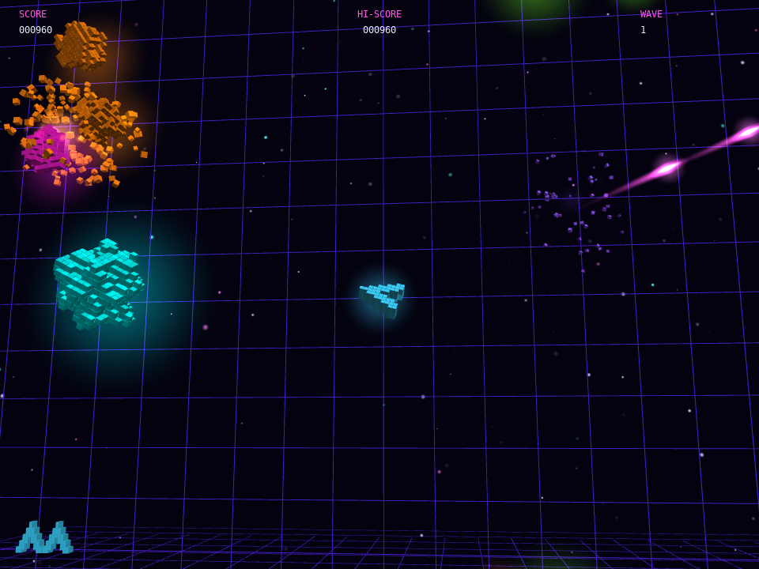

# exasteroids

Version: see `VERSION` (major.build, shown in the window title; the major number is 1).

A neon-voxel take on the classic Asteroids arcade game. Fly a thrust-and-inertia ship around a wrapping playfield and shoot the rocks. Each rock is a lumpy 3D voxel blob; a shot rock splits into two or three smaller lumps and throws out a shower of individual voxels that tumble, drift and fade away. Only the lumps are a hazard, the loose voxels are purely visual.

## What it shows
- Procedurally generated voxel rocks (a bulged sphere with craters, reduced to its surface shell) drawn as instanced 3D boxes and tumbling about random axes
- Splitting rocks (big, medium, small) and a fading voxel shower that shrinks and turns transparent
- A wrapping playfield, with objects drawn on both sides of an edge as they cross it
- Emissive voxels, additive glows, local lights from shots and explosions, and a bloom post-process for the neon look
- Synthesized sound via `generate_sample()`, including a heartbeat that speeds up as rocks thin out
- `--autoplay` for a bot demonstration and `--shot FILE --shot-at SECONDS` for screenshot capture

## Controls
Left and Right turn the ship, Up thrusts (the ship keeps its momentum), Space fires, Enter starts or restarts, and Esc quits. An extra ship is awarded every 10,000 points.

## Run
`./build/exasteroids` from the repository root.
