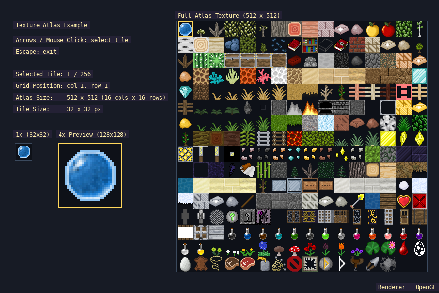

# exatlas

Texture atlas browser: pick a tile from a grid atlas and see it drawn at 4x next to the full atlas texture.



## What it shows
- Building an atlas from a bitmap with `create_atlas`
- Drawing individual tiles with `atlas_blit` and scaled with `atlas_stretch_blit`
- Mapping mouse position to a grid cell
- Showing tile index, grid position, atlas size and tile size as live text

## Running
```bash
./build/exatlas
```

Accepts `--gl`, `--vulkan` and `--d3d12` (Windows only) to choose the graphics backend; the default is OpenGL on Linux and Direct3D 12 on Windows. Loads its atlas image from `assets/textures/`, so run from the repository root.

## Controls
| Input | Action |
|-------|--------|
| Arrow keys | Move the selected tile |
| Mouse click | Select the tile under the cursor |
| Escape | Exit |

## Key APIs
- `create_atlas`, `atlas_blit`, `atlas_stretch_blit`, `draw_sprite` — [Atlases](../api_reference.md#atlases--animated-sprites-includeatlash-includeanimated_spriteh) · [`atlas.h`](../../include/atlas.h)
- `mouse_x`, `mouse_y`, `mouse_buttons` — [Events](../api_reference.md#events-input--timing-includeeventh-includeinputh-includesystemh-includegamepadh) · [`event.h`](../../include/event.h)
- `rect`, `rectfill`, `gprintf` — [Bitmaps](../api_reference.md#bitmaps-offscreen-render-targets--drawing-includedrawh) · [`draw.h`](../../include/draw.h)

## Source
[src/examples/exatlas/exatlas.cpp](../../src/examples/exatlas/exatlas.cpp)

## See also
- [exanimsprite](exanimsprite.md)
- [extilemap](extilemap.md)
- [exbitmap](exbitmap.md)
