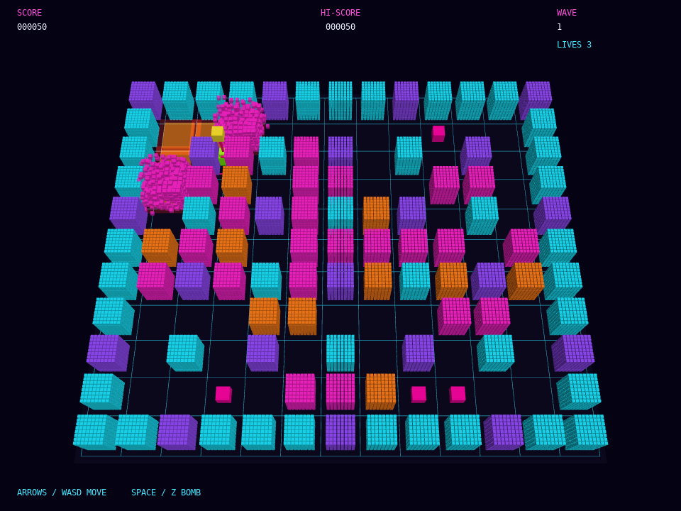

# exbomberman

A single-player, Bomberman-inspired arcade game in a tilted 3D neon-voxel arena. Place timed bombs, avoid their cross-shaped blasts, outsmart pursuing bots, and open routes through slender, full-height destructible walls made from 8×8×8 voxels. A bright beacon marks the player, and hidden power-ups increase bomb range or the number of bombs you can place at once.

## What it shows
- Grid-based movement and bomb placement in a compact arcade arena
- Slender, full-height 8×8×8 voxel wall blocks, with each voxel tumbling away as a block is destroyed
- Timed cross-shaped blasts that stop at hard walls and destroy the first soft wall they reach
- Pursuing enemies, lives, score, successive waves, and hidden power-ups
- A tilted `Surface3D` view, neon emissive materials, bloom, glowing bombs and blasts, a player beacon, and synthesized arcade sound
- A brief camera shake on bomb blasts, with a stronger jolt when the player loses a life

## Controls
Arrow keys or WASD move, Space or Z places a bomb, Enter starts or restarts, and Esc quits. `--autoplay` runs a demo; `--shot FILE --shot-at SECONDS` saves a screenshot and exits.

## Run
`./build/exbomberman` from the repository root.

## Source
[src/examples/exbomberman/exbomberman.cpp](../../src/examples/exbomberman/exbomberman.cpp)
