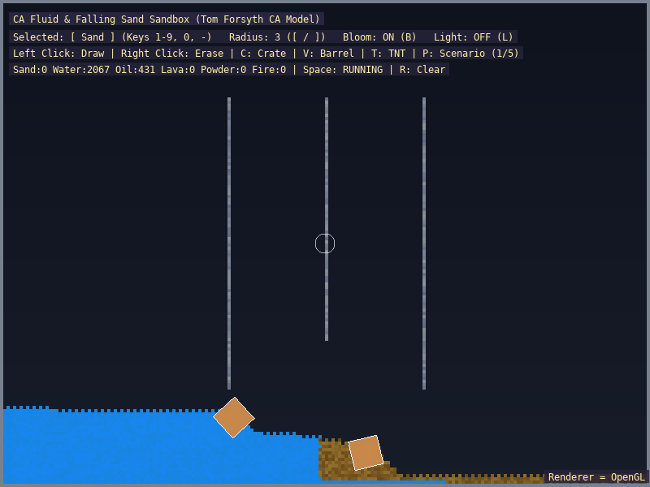

# excafluid

A falling-sand style sandbox: a multi-material cellular-automata fluid engine coupled to Box2D bodies, with lighting and bloom.



## What it shows
- 14 materials with heat conduction, phase changes and buoyancy
- Spray materials with the mouse
- Box2D rigid bodies (wood, metal, tank boxes) floating and sinking in the fluid
- Preset scenarios
- Optional lighting and bloom

## Key code

In `excafluid.cpp`, mouse input paints the selected material into the grid or erases it.
```cpp
        const int mx = sl::mouse_x();
        const int my = sl::mouse_y();
        const int gx = mx / static_cast<int>(CELL_SCALE);
        const int gy = my / static_cast<int>(CELL_SCALE);
        const std::uint32_t buttons = sl::mouse_buttons();

        if (buttons & 1) // Left click: Paint selected element
        {
            grid.paint(gx, gy, selected_element, brush_radius);
        }
        else if (buttons & 4) // Right click: Erase / Vacuum
        {
            grid.paint(gx, gy, ElementType::Empty, brush_radius + 1);
        }
```

In `excafluid.cpp`, `fluid_step` advances the engine simulation and synchronizes its cells for rendering.
```cpp
        void update(sl::PhysicsWorld *physics)
        {
            if (!simulation_)
                return;

            // Run the core CA simulation from the engine
            sl::fluid_step(simulation_);

            // Sync engine state to local buffer for rendering only
            sync_from_engine();

            current_turn_ = sl::fluid_turn(simulation_);
        }
```

In `excafluid.cpp`, submerged fluid density applies buoyancy to Box2D bodies, while their velocity determines the drag force.
```cpp
                    if (total_cells > 0 && submerged_cells > 0)
                    {
                        const float submerged_ratio = static_cast<float>(submerged_cells) / static_cast<float>(total_cells);
                        const float avg_fluid_density = fluid_density_sum / static_cast<float>(submerged_cells);

                        // Archimedes Buoyancy Force in pixel force units:
                        // Accurately balanced with Box2D gravity (600.0 px/s^2)
                        const float buoyancy = submerged_ratio * avg_fluid_density * (box.width * box.height * 600.0f) / 4096.0f;
                        sl::apply_physics_force(box.body, {0.0f, -buoyancy});

                        // Fluid Drag / Damping:
                        const float mass_px = (box.width * box.height * box.density) / 4096.0f;
                        const float drag_x = -vel.x * 2.5f * submerged_ratio * mass_px;
                        const float drag_y = -vel.y * 3.5f * submerged_ratio * mass_px;
                        sl::apply_physics_force(box.body, {drag_x, drag_y});
                    }
```

## Running
## Running
```bash
./build/excafluid
```

Accepts `--gl`, `--vulkan` and `--d3d12` (Windows only) to choose the graphics backend; the default is OpenGL on Linux and Direct3D 12 on Windows.

## Controls
| Input | Action |
|-------|--------|
| Mouse (hold) | Spray the selected material |
| 1-9, 0, - | Choose Sand, Water, Oil, Fire, Wood, Solid, Acid, Lava, Gunpowder, Plant, Pump |
| [ / ] | Brush radius |
| Space | Pause |
| R | Clear |
| P | Next scenario |
| C / V / T | Spawn a box at the cursor |
| B | Toggle bloom |
| L | Toggle lighting |
| Escape | Exit |

## Key APIs
- Fluid grid and Box2D coupling — [Cellular Automata](../api_reference.md#cellular-automata-fluid--granular-simulation-includefluidh) · [`fluid.h`](../../include/fluid.h)
- `Bloom`, lighting — [Post-Processing](../api_reference.md#post-processing-graphics-effects-includegraphics_fxh) · [`graphics_fx.h`](../../include/graphics_fx.h)

## Source
[src/examples/excafluid/excafluid.cpp](../../src/examples/excafluid/excafluid.cpp)

## See also
- [exfluid3d](exfluid3d.md)
- [exphysics](exphysics.md)
- [exlighting](exlighting.md)

Deep dive: [Cellular Automata Fluid guide](../excafluid_guide.md).
