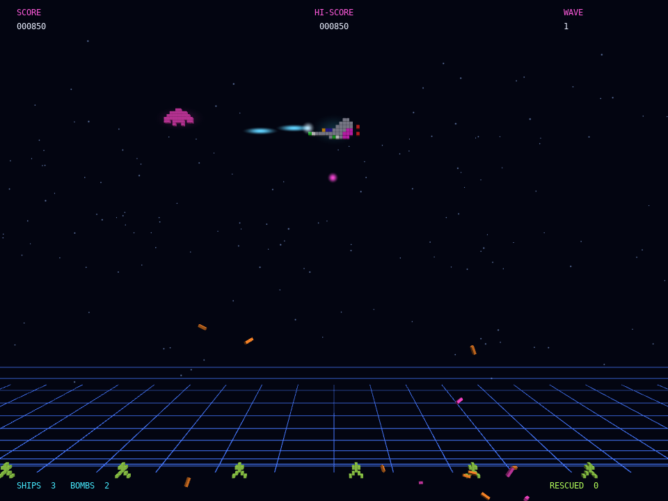

# exdefender

A neon-voxel tribute to the classic side-scrolling space-rescue arcade game. Move a ship through a wraparound playfield, break up alien waves, and rescue people from the ground or before they fall. The ship stays level and faces left or right; movement is direct rather than thrust-based. Voxel ships and enemies shatter into tumbling 3D debris while additive explosions bloom across a starfield.

## What it shows
- A complete arcade game loop with four-direction movement, wraparound, enemy waves, lives, scoring and a smart bomb
- Pixel-art sprites rendered as instanced 3D voxel boxes, with a fixed horizontal ship silhouette that flips to face left or right
- Rescuable people, descending bomber enemies and enemy projectiles
- 3D rigid-body debris using `RigidBoxWorld3D`, additive explosion glows and a bloom post-process
- Synthesized laser, explosion and rescue sound effects via `generate_sample()`
- `--autoplay` for a bot demonstration and `--shot FILE --shot-at SECONDS` for screenshot capture

## Controls
Arrow keys move up, down, left and right. The ship does not rotate; it faces in the direction of horizontal movement. Space fires, Z uses a smart bomb, Enter starts or restarts, and Esc quits.

## Run
`./build/exdefender` from the repository root.
