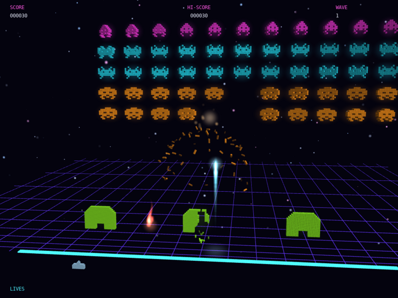

# exinvaders

Version: see `VERSION` (major.build, shown in the window title; the major number is 1).

Classic Space Invaders in glowing neon voxels. The invaders, the cannon, the three shields and the mystery ship are all built from 3D boxes, and the camera sits side-on so the play is the same as the 2D original. When something is hit its voxels shatter into tumbling debris that fades away while an additive flash blooms where it died.



## What it shows
- Voxel sprites: each alien is a pixel-art grid turned into instanced cubes with `draw_mesh_instanced()`, one batch per colour, with emissive lit materials
- Per-voxel damage: bombs and missiles carve ragged craters out of the shields, and invaders that reach a shield eat it
- 3D rigid-body debris with `RigidBoxWorld3D` (`physics3d.h`): every destroyed voxel becomes a box with mass, inertia and spin that falls, bounces and tumbles on the floor, with `explode()` supplying the blast impulse and `lifetime` removing it. Box2D is 2D only, so this module adds the 3D collisions, inertia and rotation the effect needs
- Fading: debris shrinks and turns transparent with `MaterialBlend::alpha` as its lifetime runs out
- Glow: the whole 3D surface goes through `Bloom`; missiles, bombs, explosion flashes and sparks are additive billboards using one soft sprite
- A receding neon floor grid and twinkling stars behind the action, and a little camera sway so the depth reads
- Synthesised sound with `generate_sample()`: shots, explosions and the four-note marching bass that speeds up as invaders die

## Key code

A destroyed alien's voxels become debris, pushed away from a point behind it so they fly towards the camera:

```cpp
sl::RigidBoxWorld3D burst;
for (const glm::vec3 &p : voxels)
{
    sl::RigidBox3D body;
    body.position = p;
    body.half_extents = {0.18f, 0.18f, 0.32f};
    body.lifetime = 1.2f + 1.0f * uniform();
    burst.add(body);
}
burst.explode({x, y - 1.0f, -2.0f}, 6.0f, 26.0f, 9.0f);
```

## Controls
Left and Right arrows move, Space fires, Enter starts or restarts, Esc quits. `--autoplay` lets a bot play; `--shot FILE --shot-at SECONDS` saves a screenshot and exits.

## Run
`./build/exinvaders` from the repository root.
