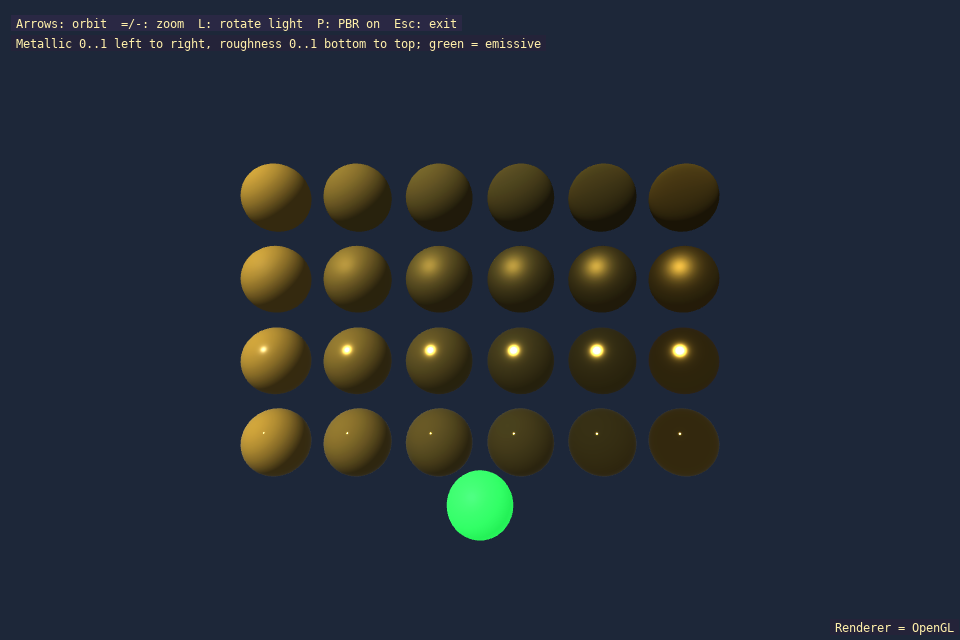

# expbr

Physically based rendering: a grid of spheres varying metallic and roughness, with an emissive sphere and a toggle for the PBR path.



## What it shows
- PBR `Material` parameters: metallic, roughness and emissive
- A sphere grid: metallic 0 to 1 left to right, roughness 0 to 1 bottom to top
- Orbit camera and a rotating light
- Toggling PBR against the classic lighting model
- Saving a screenshot with `save_bitmap` when `RSIMLIB_SCREENSHOT=<file>` is set

## Key code

In `expbr.cpp`, metallic and roughness vary across a sphere grid, while the emissive material gives a separate sphere its green glow.
```cpp
            for (int row = 0; row < rows; ++row)
                for (int column = 0; column < columns; ++column)
                {
                    sl::Material material;
                    material.tint = {215, 170, 60, 255};
                    material.pbr = pbr;
                    material.metallic = static_cast<float>(column) / (columns - 1);
                    material.roughness = std::max(0.05f, static_cast<float>(row) / (rows - 1));
                    const glm::vec3 position((column - (columns - 1) * 0.5f) * 1.1f, (row - (rows - 1) * 0.5f) * 1.1f, 0.0f);
                    sl::draw_mesh(sphere, glm::translate(glm::mat4(1.0f), position), material);
                }
            sl::Material glow;
            glow.tint = {40, 40, 40, 255};
            glow.pbr = pbr;
            glow.metallic = 0.0f;
            glow.roughness = 0.6f;
            glow.emissive[0] = 0.1f;
            glow.emissive[1] = 0.9f;
            glow.emissive[2] = 0.3f;
```
## Running
```bash
./build/expbr
```

Accepts `--gl`, `--vulkan` and `--d3d12` (Windows only) to choose the graphics backend; the default is OpenGL on Linux and Direct3D 12 on Windows.

## Controls
| Input | Action |
|-------|--------|
| Arrow keys | Orbit the camera |
| = / - | Zoom in / out |
| L | Rotate the light |
| P | Toggle PBR |
| Escape | Exit |

## Key APIs
- `create_surface_3d`, `begin_surface_3d`, `end_surface_3d` — [3D Surfaces](../api_reference.md#3d-surfaces-includesurface3dh) · [`surface3d.h`](../../include/surface3d.h)
- `create_sphere_mesh`, `draw_mesh`, `Material`, `Camera`, `set_light_3d` — [3D Surfaces](../api_reference.md#3d-surfaces-includesurface3dh) · [`surface3d.h`](../../include/surface3d.h)
- `save_bitmap` — [Bitmaps](../api_reference.md#bitmaps-offscreen-render-targets--drawing-includedrawh) · [`draw.h`](../../include/draw.h)

## Source
[src/examples/expbr/expbr.cpp](../../src/examples/expbr/expbr.cpp)

## See also
- [exnormalmap3d](exnormalmap3d.md)
- [exmodel3d](exmodel3d.md)
- [exmipmap](exmipmap.md)
