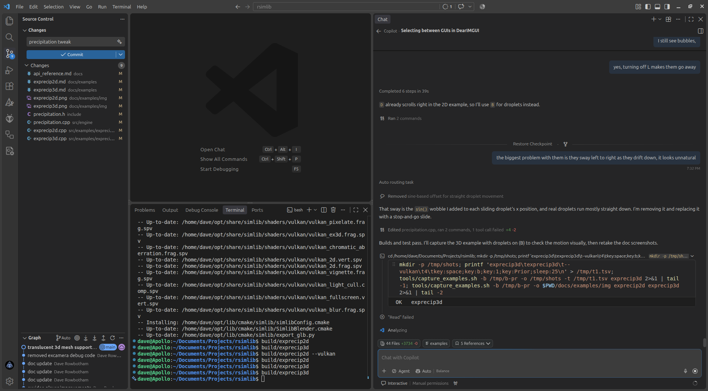

# exprecip2d

Rain, hail and snow over a scrolling night city: splashes, wind, snow that piles up on the rooftops, lens droplets and a matching sound bed.



## What it shows
- `Precipitation2D` particles that land on any ground profile (here the rooftops) and spawn ripples or bounces
- Presets and smooth transitions between weather types (`transition_to`)
- Wind that slants the fall, adjustable at run time
- Snow accumulating on surfaces, then slumping and melting
- `PrecipitationLens` raindrops/frost on the "camera", and `PrecipitationAudio` noise beds

## Key code

In `exprecip2d.cpp`, the ground is a function of screen x, so drops splash on rooftops instead of the screen bottom:

```cpp
sl::Precipitation2D precipitation(window_w, window_h);
precipitation.set_ground([&scroll](float screen_x) { return surface_at(screen_x + scroll); });
precipitation.set_max_particles(1800);
sl::PrecipitationLens lens;
sl::PrecipitationAudio sound;
```

Changing weather fades the old type out and the new one in:

```cpp
sl::PrecipitationConfig target = sl::precipitation_preset(type, level);
precipitation.weather.transition_to(target, 3.0f);
```

Each frame, scroll the world, update, then draw on top of the scene:

```cpp
precipitation.scroll(move, 0.0f);
precipitation.update(dt);
lens.update(dt, precipitation.weather.current());
sound.update(precipitation.weather.current());
// ... draw the scene ...
precipitation.draw();
```

## Running
```bash
./build/exprecip2d
```

Accepts `--gl`, `--vulkan` and `--d3d12` (Windows only) to choose the graphics backend; the default is OpenGL on Linux and Direct3D 12 on Windows.

## Controls
| Input | Action |
|-------|--------|
| 1 / 2 / 3 | Rain / hail / snow |
| 0 | Clear weather |
| Up / Down | Stronger / lighter |
| Q / E | Wind left / right |
| Left / Right | Scroll the city |
| L | Toggle lens haze |
| B | Toggle lens droplets (off by default) |
| M | Toggle sound |
| Escape | Exit |

## Key APIs
- `Precipitation2D`, `PrecipitationController`, `PrecipitationLens`, `PrecipitationAudio` — [Precipitation](../api_reference.md#precipitation-includeprecipitationh) · [`precipitation.h`](../../include/precipitation.h)

## Source
[src/examples/exprecip2d/exprecip2d.cpp](../../src/examples/exprecip2d/exprecip2d.cpp)

## See also
- [exprecip3d](exprecip3d.md)
- [exparticles](exparticles.md)
