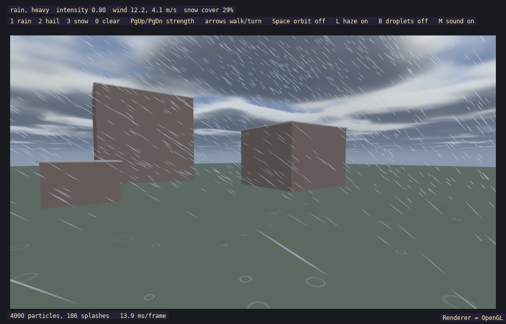

# exprecip3d

Rain, hail and snow falling around a 3D camera, driven by the cloud layer's wind, with fog and sky tinted by the weather and snow whitening the ground.



## What it shows
- `Precipitation3D`: a box of particles that follows the camera, drawn as alpha-blended instanced camera-facing quads (streaks for rain and hail, flakes for snow)
- Splashes on the ground and hail bounces, using any ground height function
- Wind taken from the `CloudLayer` (`wind_from_clouds`)
- `precipitation_apply_environment` darkening the sky and thickening fog
- `snow_cover()` and `snow_tinted()` to whiten surfaces as snow accumulates
- Lens haze with optional droplets, and a synthesised weather sound (no sound files), as in the 2D example

## Key code

In `exprecip3d.cpp`, set up the ground, accumulation rates and extras:

```cpp
sl::Precipitation3D precipitation;
precipitation.set_ground(surface_height);
precipitation.set_accumulation(0.04f, 0.03f);
sl::PrecipitationLens lens;
sl::PrecipitationAudio sound;   // sound.update(weather) each frame; optional master volume 0-255, default 26
```

Wind follows the clouds, stronger in heavier weather:

```cpp
sl::PrecipitationConfig target = sl::precipitation_preset(type, level);
target.wind = sl::Precipitation3D::wind_from_clouds(clear_sky.clouds, 0.3f + 0.9f * target.intensity);
precipitation.weather.transition_to(target, 3.0f);
```

Per frame: update with the camera, tint the scene, then draw:

```cpp
precipitation.update(dt, camera);
const float cover = precipitation.snow_cover();
sl::precipitation_apply_environment(environment, weather);
material.tint = sl::snow_tinted({70, 96, 64, 255}, cover);
// ... draw the scene ...
precipitation.draw(camera);
```

`Precipitation3D` frees its GPU mesh and textures in its destructor (or earlier with `release()`). If it outlives `sl::shutdown()` the destructor safely does nothing.

## Running
```bash
./build/exprecip3d
```

Accepts `--gl`, `--vulkan` and `--d3d12` (Windows only) to choose the graphics backend; the default is OpenGL on Linux and Direct3D 12 on Windows.

## Controls
| Input | Action |
|-------|--------|
| 1 / 2 / 3 | Rain / hail / snow |
| 0 | Clear weather |
| PgUp / PgDn | Stronger / lighter |
| Arrow keys | Walk and turn |
| Space | Toggle camera orbit |
| L | Toggle lens haze |
| B | Toggle lens droplets (off by default) |
| M | Toggle sound |
| F3 | Toggle the frame stats overlay (`sl::draw_frame_stats`) |
| Escape | Exit |

## Key APIs
- `Precipitation3D`, `precipitation_apply_environment`, `snow_tinted` — [Precipitation](../api_reference.md#precipitation-includeprecipitationh) · [`precipitation.h`](../../include/precipitation.h)
- `draw_mesh_instanced` — [3D Surfaces](../api_reference.md#3d-surfaces-includesurface3dh)

## Source
[src/examples/exprecip3d/exprecip3d.cpp](../../src/examples/exprecip3d/exprecip3d.cpp)

## See also
- [exprecip2d](exprecip2d.md)
- [exinstancing](exinstancing.md)
