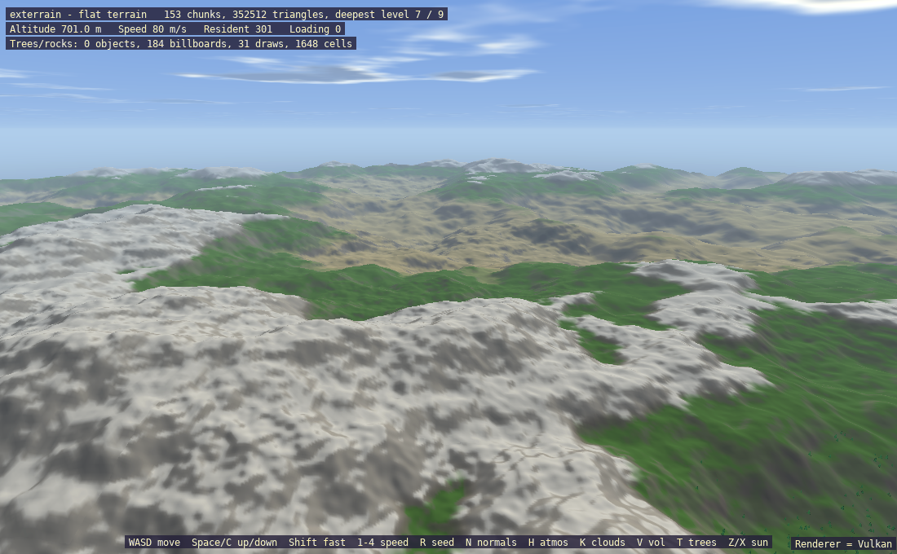

# exterrain

A fly-over procedural terrain with normals, atmosphere, clouds, volumetrics, and instanced trees and rocks.


## What it shows
- Procedural terrain generation and reseeding
- Normal visualisation
- Atmosphere and sun control
- Cloud layers and volumetric clouds
- Trees and rocks as objects and billboards with draw statistics
- A lantern (`L`) placed in the world: a shadow-casting point light that lights the terrain and casts a crate's shadow on it (`LocalShadowMap3D`)

## Key code

In `exterrain.cpp`, the terrain is rebuilt from a seeded noise source whenever the seed changes, with normal maps switchable per layer:

```cpp
sl::NoiseParameters noise;
noise.seed = seed;
sl::TerrainConfig config;
// ...
config.layers = sl::default_terrain_layers(0.0, planet ? 6000.0 : 180.0);
for (std::size_t i = 0; i < config.layers.size() && i < 4; ++i)
{
    config.layers[i].albedo = layer_albedo[i];
    config.layers[i].normal_map = use_normals ? layer_normal[i] : nullptr;
    config.layers[i].tile_metres = planet ? 32.0 : 16.0;
}
terrain = std::make_unique<sl::Terrain>(config, std::make_shared<sl::NoiseSource>(noise));
```

Atmosphere, sun and clouds come from an `Environment3D`, and the terrain and clutter (trees and rocks) are drawn in the 3D surface:

```cpp
environment.sun_direction = glm::vec3(-to_sun);
environment.fog_enabled = use_atmosphere;
environment.clouds.enabled = use_atmosphere && use_clouds;
environment.clouds.volumetric = volumetric;
// ...
sl::set_environment_3d(environment);
sl::draw_sky_3d();
// ...
terrain->draw(position, material);
if (use_clutter)
    clutter->draw(position);
```

Draw statistics are read back for the on-screen readout:

```cpp
const sl::ClutterStats cs = clutter->stats();
sl::gprintf(12, 46, {20, 20, 20}, "Trees/rocks: %d objects, %d billboards, %d draws, %d cells", cs.drawn_objects,
            cs.drawn_billboards, cs.drawn_meshes, cs.cached_cells);
```

## Running
```bash
./build/exterrain
```

Accepts `--gl`, `--vulkan` and `--d3d12` (Windows only) to choose the graphics backend; the default is OpenGL on Linux and Direct3D 12 on Windows.

## Controls
| Input | Action |
|-------|--------|
| W A S D | Move |
| Space / C | Up / down |
| Shift | Fast |
| 1-4 | Speed |
| R | New seed |
| N | Toggle normals |
| H | Toggle atmosphere |
| K | Toggle clouds |
| V | Toggle volumetrics |
| T | Toggle trees |
| Z / X | Move the sun |
| Escape | Exit |

## Key APIs
- Terrain — [Chunked-LOD](../api_reference.md#chunked-lod-terrain-includeterrainh) · [`terrain.h`](../../include/terrain.h)
- Atmosphere and clouds — [Atmosphere](../api_reference.md#atmosphere--clutter-includeatmosphereh-includeclutterh) · [`atmosphere.h`](../../include/atmosphere.h)
- `Surface3D` — [3D Surfaces](../api_reference.md#3d-surfaces-includesurface3dh) · [`surface3d.h`](../../include/surface3d.h)
- Noise — [Procedural FastNoise](../api_reference.md#procedural-fastnoise-generation-includenoiseh) · [`noise.h`](../../include/noise.h)

## Source
[src/examples/exterrain/exterrain.cpp](../../src/examples/exterrain/exterrain.cpp)

## See also
- [exclouds](exclouds.md)
- [exflight](exflight.md)
- [exvoxel](exvoxel.md)

The same scene on the Vulkan backend (`--vulkan`):


