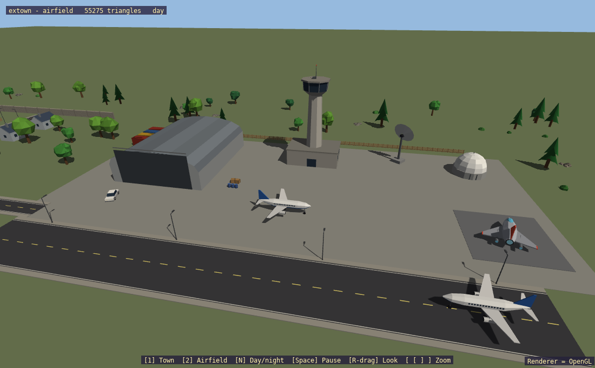
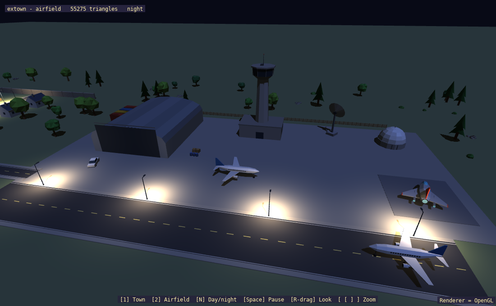

# extown

A town and airfield assembled from the `props3d.h` parts: roads, houses, fences, lamps, offices, skyscrapers, cars, a water tower, tank farm and container yard, plus a hangar, control tower, radars, airliners and a spaceship pad. About 150 trees, bushes and rocks are scattered by hash, about 55k triangles in all.





## What it shows
- `bake_instances()` merging many copies of each part into one mesh, so the whole scene is a few dozen draws
- Placing parts with `Instance3D` position, yaw and scale
- Sun shadows by day; at night the 16 street lamps nearest the camera target become `LocalLight3D`s

## Key code

```cpp
std::vector<sl::Instance3D> houses = {{{-13, 0, 0}, 1.5708f}, {{13, 0, 8}, -1.5708f}};
sl::Mesh *mesh = sl::bake_instances(sl::make_house_data(), houses);
```

## Controls
`1` town view, `2` airfield view, `N` day/night, `Space` pauses the orbit, right-drag looks, `[` / `]` zoom.

## Running
```
./build/extown            # or --gl / --vulkan
```

Tested on OpenGL. See the lesson [Building a scene from parts](../tutorial/3d-06-building-a-scene-from-parts.md).
