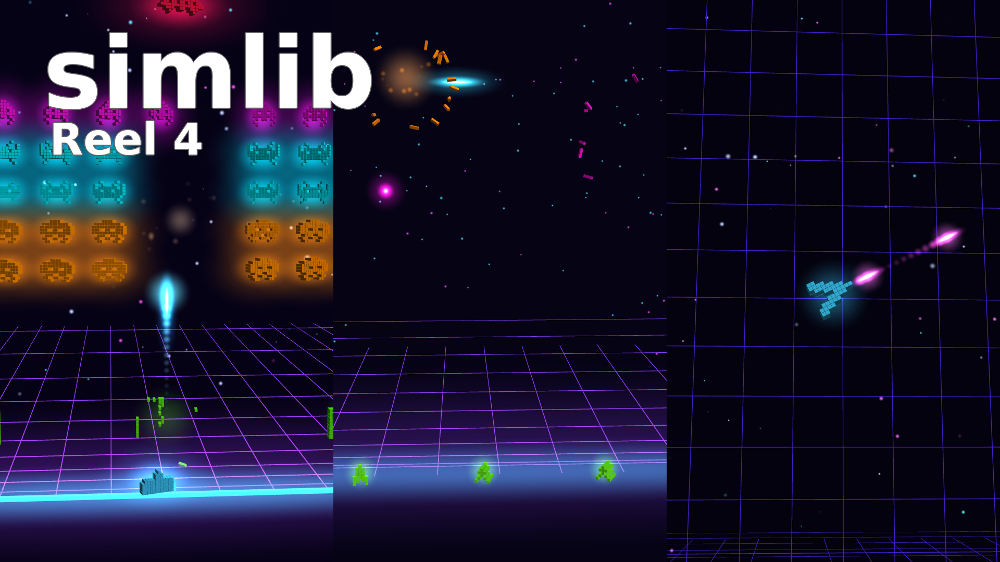
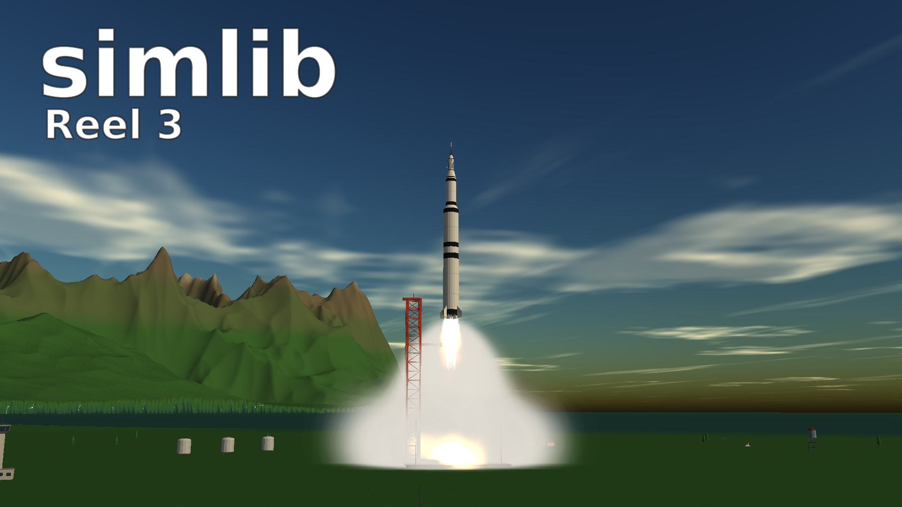
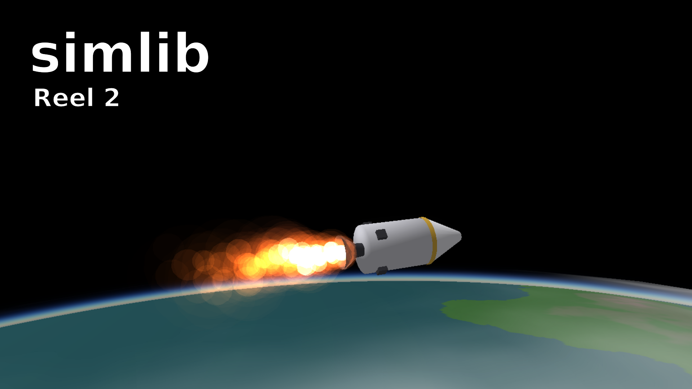
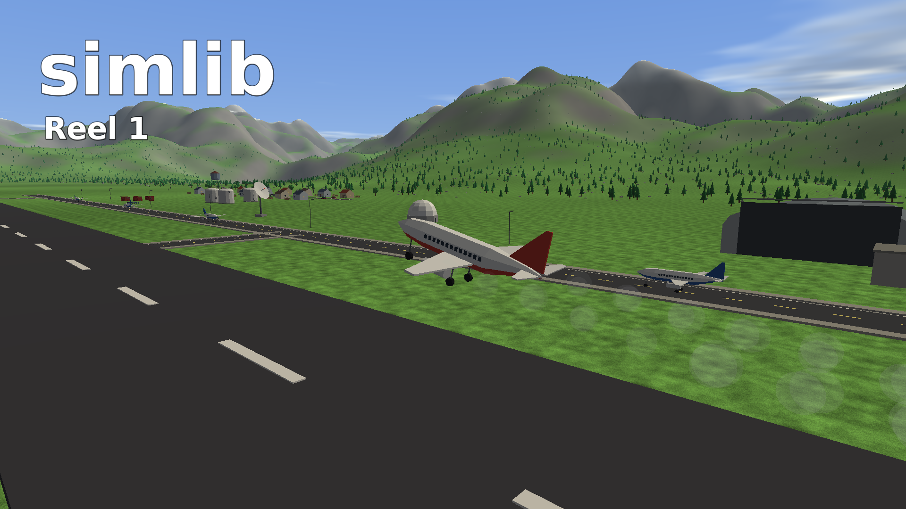

# Showreel Gallery

[← Back to README](../README.md)

**[Showreel 4](https://www.youtube.com/watch?v=KE_AFGd7Tj0)**: the three neon arcade games, [exinvaders](examples/exinvaders.md), [exdefender](examples/exdefender.md) and [exasteroids](examples/exasteroids.md), each played by its own autoplay bot to a techno beat, rendered entirely by simlib itself with HDR bloom, emissive voxels and rigid-body debris.

Films rendered entirely by simlib. All of them are in the [simlib playlist on YouTube](https://www.youtube.com/playlist?list=PLUxsfSDozX5k).

<table>
  <tr>
    <td align="center" width="50%">
       
      <b><a href="https://www.youtube.com/watch?v=8g6SrcvGjKM">Showreel 3</a></b> 
      A Saturn V-style launch to orbit, with mountains, staging, stars and an ambient finale.
    </td>
    <td align="center" width="50%">
       
      <b><a href="https://www.youtube.com/watch?v=XAhfCniKO2k">Showreel 2</a></b> 
      Storms and warships, airliners, 3D cockpits and an orbital burn.
    </td>
  </tr>
  <tr>
    <td align="center" width="50%">
       
      <b><a href="https://www.youtube.com/watch?v=D1dyvnGUUNw">Showreel 1</a></b> 
      A three-minute tour of simlib.
    </td>
    <td></td>
  </tr>
</table>
