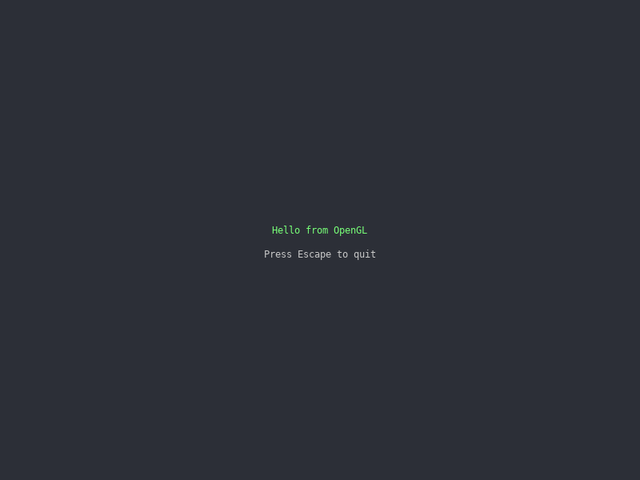

# Lesson 0: Your first window

[← Tutorial index](README.md)

**Goal:** open a window and run a game loop that closes cleanly.



## The idea

Every game is a loop: read input, update the world, draw a frame, repeat. simlib gives you four calls for it:

| Call | What it does |
|------|--------------|
| `sl::set_gfx_mode(...)` | Opens the window and starts a graphics backend (OpenGL, Vulkan or D3D12). |
| `sl::poll_event(&event)` | Hands you the next pending input or window event; loop until it returns false. |
| `sl::show_video_bitmap()` | Presents what you drew this frame. |
| `sl::end_frame()` | Ends the frame, records its duration and waits if you set a frame rate cap. |

Everything is drawn onto `sl::screen`, a bitmap that represents the window. Colours are `sl::Colour{red, green, blue}` (0–255, optional alpha).

## The program

```cpp
#include "sl.h"

int main(int argc, char *argv[])
{
    if (!sl::configure_graphics_backend_from_args(argc, argv) ||
        !sl::set_gfx_mode(sl::GFX_AUTODETECT_WINDOWED, 800, 600))
    {
        return -1;
    }
    sl::set_fps(60);

    bool running = true;
    while (running)
    {
        sl::Event event;
        while (sl::poll_event(&event))
        {
            if (event.type() == sl::Event::Type::quit ||
                (event.type() == sl::Event::Type::key_down && event.key() == sl::Event::Key::escape))
            {
                running = false;
            }
            sl::display_handle_event(event);
        }

        sl::clear_to_colour(sl::screen, {45, 48, 56});
        sl::gprintf_center(280, {120, 255, 120}, "Hello from %s", sl::graphics_backend_name().c_str());
        sl::gprintf_center(310, {200, 200, 200}, "Press Escape to quit");

        sl::show_video_bitmap();
        sl::end_frame();
    }

    sl::wait_for_graphics();
    sl::shutdown();
    return 0;
}
```

## What just happened

- `configure_graphics_backend_from_args` reads `--gl`, `--vulkan` or `--d3d12` so you can switch backends from the command line. The choice is made once at start-up.
- `set_gfx_mode` can fail (no display, no driver), so check it and return.
- `display_handle_event(event)` lets the library react to things like window resizes. Call it for every event.
- `set_fps(60)` caps the loop so it doesn't spin the CPU. `sl::get_frame_time()` returns the last frame's duration in milliseconds, which later lessons use to move things at a steady speed.
- `wait_for_graphics()` then `shutdown()` finish any GPU work and release everything. Do this once, last.

## Try it

1. Change the background colour, then the window size.
2. Run with `--vulkan` and `--gl`; the text shows which backend you got.
3. Call `sl::draw_frame_stats(nullptr, 10, 10)` just before `show_video_bitmap()` to see the frame rate.

## Go further

- Example: [`exhello`](../examples/exhello.md). API: [Application Lifecycle & Display](../api_reference.md#application-lifecycle--display-includedisplayh).
- Next: [Drawing and moving things](2d-01-drawing-and-input.md).
