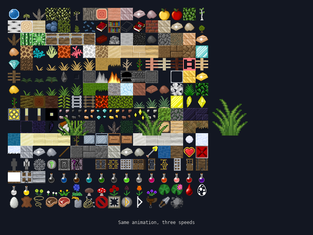

# Lesson 2 (2D): Sprites and animation

[← Tutorial index](README.md) · Previous: [Drawing and moving things](2d-01-drawing-and-input.md)

**Goal:** load an image, draw it, and play an animation from a sheet of frames.



## The idea

- A **bitmap** is an image. `sl::load_bitmap(path)` reads PNG and other common formats; `sl::draw_sprite(bitmap, x, y)` draws it with its top-left at `(x, y)`.
- A **sprite sheet** (or *atlas*) packs many equally sized frames into one image, which is faster than many small files. `sl::create_atlas(bitmap, tile_width, tile_height)` describes the grid; tile `0` is the top-left cell, numbered across then down.
- An **animated sprite** steps through consecutive tiles: `sl::create_animated_sprite(atlas, first_tile, frame_count, x, y, width, height, seconds_per_frame)`. An `AnimationManager` updates and draws a set of them.
- A bitmap you load must be destroyed with `sl::destroy_bitmap`.

The sheet used here is `assets/textures/atlas_grid.png`, 512×512 pixels, a 16×16 grid of 32×32 tiles.

## The program

```cpp
#include "sl.h"

int main(int argc, char *argv[])
{
    if (!sl::configure_graphics_backend_from_args(argc, argv) ||
        !sl::set_gfx_mode(sl::GFX_AUTODETECT_WINDOWED, 800, 600))
    {
        return -1;
    }
    sl::set_fps(60);

    sl::Bitmap *sheet = sl::load_bitmap("assets/textures/atlas_grid.png");
    if (!sheet)
    {
        return -1;
    }
    const sl::Atlas atlas = sl::create_atlas(sheet, 32, 32);

    sl::AnimationManager manager;
    // Three copies of the same 5-frame plant growth loop (tiles 97 to 101) at different speeds.
    const float seconds_per_frame[] = {0.12f, 0.06f, 0.03f};
    for (int i = 0; i < 3; ++i)
    {
        sl::AnimatedSprite sprite =
            sl::create_animated_sprite(atlas, 97, 5, 140 + i * 200, 250, 96, 96, seconds_per_frame[i]);
        manager.add_animated_sprite(sprite);
    }

    bool running = true;
    while (running)
    {
        sl::Event event;
        while (sl::poll_event(&event))
        {
            if (event.type() == sl::Event::Type::quit ||
                (event.type() == sl::Event::Type::key_down && event.key() == sl::Event::Key::escape))
                running = false;
            sl::display_handle_event(event);
        }

        manager.update();

        sl::clear_to_colour(sl::screen, {20, 24, 34});
        sl::draw_sprite(sheet, 20.0f, 20.0f); // the whole sheet, for reference
        manager.draw_sprites(sl::screen);
        sl::gprintf_center(560, {200, 200, 200}, "Same animation, three speeds");

        sl::show_video_bitmap();
        sl::end_frame();
    }

    sl::wait_for_graphics();
    sl::destroy_bitmap(sheet);
    sl::shutdown();
    return 0;
}
```

## What just happened

- The atlas doesn't copy pixels. It remembers the sheet and the grid, so keep the bitmap alive while you use it.
- Each `AnimatedSprite` has its own position and size; here the 32×32 tiles are drawn at 96×96. `manager.update()` advances the frame timers using the real frame time.
- Add `one_shot = true` (the next two arguments of `create_animated_sprite`) for an animation that plays once, like an explosion, then removes itself.

## Try it

1. Change the sprites to start on a different tile (the second argument) and use a different frame count (the third) to play another part of the sheet. A row is 16 tiles, so row 1 starts at tile 16. Try the potion bottles on row 13, tiles 211 to 223.
2. Draw a single tile yourself without the manager: `sl::draw_sprite_region_flipped(sheet, sx, sy, 32, 32, x, y, 64, 64, false, false)` copies the `sx, sy` rectangle of the sheet to `x, y`, scaled to 64×64. Flip the booleans to mirror it.
3. Add an `Event::Type::mouse_button_down` check that creates a one-shot sprite at the mouse position.

## Go further

- Examples: [`exanimsprite`](../examples/exanimsprite.md), [`exatlas`](../examples/exatlas.md). API: [Atlases & Animated Sprites](../api_reference.md#atlases--animated-sprites-includeatlash-includeanimated_spriteh).
- Next: [Tile maps and collision](2d-03-tilemaps-and-collision.md).
