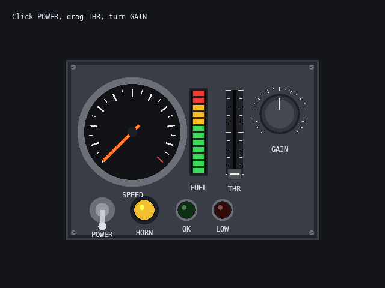

# Lesson 5 (2D): Control panels

[← Tutorial index](README.md) · Previous: [Text and sound](2d-04-text-and-sound.md)

**Goal:** build an instrument panel with a dial, a level meter, a slider, a knob, a toggle, a button and two lamps, operate it with the mouse and make the lamps glow.



## The idea

- A **`ControlPanel`** holds controls and their state, and does the mouse handling. It knows nothing about drawing, so the same panel can be drawn flat in 2D (this lesson) or as geometry in a 3D scene ([lesson 7](3d-07-a-clickable-3d-panel.md)).
- You add controls with `add_dial`, `add_knob`, `add_toggle`, `add_button`, `add_lamp`, `add_slider` and `add_meter`. Each returns an **id** (or look one up later by its label with `find()`).
- Panel coordinates are *panel units*, with the origin at the top-left corner and y pointing down. A control's position is its centre.
- Some controls are **inputs** the user changes (knob, slider, toggle, button) and some are **outputs** your program sets (dial, meter, lamp). Read inputs with `value(id)` or `on(id)`, write outputs with `set_value(id, v)` or `set_on(id, on)`.
- Each frame, call **`update(dt, pointer)`**. `control_pointer_2d()` converts the mouse position to panel coordinates for a panel drawn at a given spot and scale.
- `draw_control_panel(target, panel, x, y)` draws it. Lamps and lit meter segments have a halo, and drawing into a render target and running it through **`Bloom`** makes them glow.

## The program

```cpp
#include "sl.h"

#include <algorithm>
#include <cmath>
#include <cstdio>

int main(int argc, char **argv)
{
    if (!sl::configure_graphics_backend_from_args(argc, argv))
        return 1;
    if (!sl::set_gfx_mode(sl::GFX_AUTODETECT_WINDOWED, 640, 480))
    {
        std::fprintf(stderr, "Graphics failed: %s\n", sl::last_error().c_str());
        return 1;
    }
    sl::set_window_title("Lesson 5: control panels");
    sl::set_fps(60);

    sl::ControlPanel panel(420.0f, 300.0f);
    const int speed = panel.add_dial(110.0f, 120.0f, 160.0f, 0.0f, 100.0f, "SPEED");
    const int fuel = panel.add_meter(220.0f, 120.0f, 24.0f, 140.0f, 0.0f, 1.0f, "FUEL");
    const int throttle = panel.add_slider(280.0f, 120.0f, 140.0f, 0.0f, 1.0f, 0.0f, true, "THR");
    const int gain = panel.add_knob(355.0f, 90.0f, 60.0f, 0.0f, 1.0f, 0.5f, "GAIN");
    const int power = panel.add_toggle(60.0f, 250.0f, 34.0f, false, "POWER");
    panel.add_button(130.0f, 250.0f, 40.0f, {240, 190, 50, 255}, "HORN", false);
    const int ok = panel.add_lamp(200.0f, 250.0f, 30.0f, {60, 230, 90, 255}, false, "OK");
    const int warn = panel.add_lamp(260.0f, 250.0f, 30.0f, {240, 50, 40, 255}, false, "LOW", true);

    sl::Bitmap *scene = sl::create_render_target(640, 480);
    sl::Bloom bloom;
    const bool glow = scene && bloom.initialise();
    bloom.set_threshold(0.55f);

    float level = 1.0f, velocity = 0.0f;
    bool running = true;
    std::uint32_t last = sl::time_ms();
    while (running)
    {
        const std::uint32_t now = sl::time_ms();
        const float dt = std::clamp((now - last) * 0.001f, 0.001f, 0.1f);
        last = now;
        sl::Event event;
        while (sl::poll_event(&event))
        {
            if (event.type() == sl::Event::Type::quit ||
                (event.type() == sl::Event::Type::key_down && event.key() == sl::Event::Key::escape))
                running = false;
            sl::display_handle_event(event);
        }

        // The panel is drawn with its top-left corner at (px, py).
        const float px = 110.0f, py = 100.0f;
        panel.update(dt, sl::control_pointer_2d(px, py, 1.0f, static_cast<float>(sl::mouse_x()), static_cast<float>(sl::mouse_y()),
                                                sl::mouse_button_down(sl::MouseButton::left)));

        const float target = panel.on(power) ? 100.0f * panel.value(throttle) : 0.0f;
        velocity += (target - velocity) * std::min(1.0f, 1.5f * dt);
        level = std::max(0.0f, level - (velocity > 1.0f ? 0.01f * dt * (0.3f + panel.value(gain)) : 0.0f));
        panel.set_value(speed, velocity);
        panel.set_value(fuel, level);
        panel.set_on(ok, panel.on(power) && level > 0.2f);
        panel.set_on(warn, panel.on(power) && level <= 0.2f);

        sl::Bitmap *target_bitmap = glow ? scene : sl::screen;
        if (glow)
            sl::begin_render_target(scene);
        sl::clear_to_colour(target_bitmap, {20, 22, 28});
        sl::draw_control_panel(target_bitmap, panel, px, py);
        if (glow)
        {
            sl::end_render_target();
            bloom.apply(scene, 0, 0, 640, 480);
        }
        sl::gprintf(20, 20, {230, 235, 245}, "Click POWER, drag THR, turn GAIN");
        sl::show_video_bitmap();
        sl::end_frame();
    }
    sl::wait_for_graphics();
    bloom.shutdown();
    sl::shutdown();
    return 0;
}
```

## What just happened

- The inputs and outputs are separate. The program reads `power`, `throttle` and `gain`, runs a tiny simulation, then writes `speed`, `fuel` and the lamps. `set_value` clamps to the control's range and never reports a change.
- **Toggles** flip when clicked. **Buttons** are momentary (on while held) unless the last argument of `add_button` is `true`, which makes them latch. **Knobs** are dragged up or down (or left and right). **Sliders** jump to the pointer and then follow it.
- Dials and meters ease toward their value, so needles swing instead of snapping. `set_smoothing(rate)` changes that (0 snaps).
- A lamp with `blink` set alternates between bright and dim while it is on. `glow(id)` returns its current brightness if you want to use it elsewhere.
- `on_change(id, value)` is called only when the *user* changes a control, which is handy for playing a click sound.
- Labels are drawn with the default monospace font, so draw to the screen or the current render target. Pass your own `Font *` to `draw_control_panel` to change it.
- The bloom threshold of 0.55 lets only the bright lamps and lit meter segments bleed light; the text stays crisp.

## Try it

1. Add `panel.on_change = [](int id, float v) { std::printf("%d -> %.2f\n", id, v); };`.
2. Make the HORN button latching by passing `true` as its last argument.
3. Call `panel.set_smoothing(3.0f)` for lazier needles.
4. Draw the panel at `scale` 1.5 and pass the same scale to `control_pointer_2d`.
5. Add a second dial with a smaller sweep: `add_dial(x, y, d, 0, 8, "RPM", 180.0f)`.
6. Use the ready-made layouts: `sl::make_cockpit_panel()` and `sl::make_cabinet_panel()`, then look controls up with `find("THR")`.

## Go further

- Example: [`excontrols`](../examples/excontrols.md) (a cockpit and a factory cabinet with a small simulation behind each). API: [Control panels](../api_reference.md#control-panels-includecontrolsh).
- Next track: [Your first 3D scene](3d-01-first-scene.md); the same panel model appears in 3D in [A clickable 3D panel](3d-07-a-clickable-3d-panel.md).
