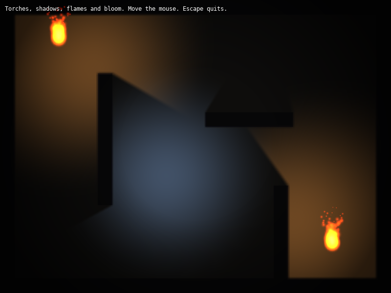

# Lesson 6 (2D): Lighting, shadows and particles

[← Tutorial index](README.md) · Previous: [Control panels](2d-05-control-panels.md)

**Goal:** light a dark room with two flickering torches and a mouse-following moonlight, cast shadows from the walls, add particle flames and finish with a vignette and bloom.



## The idea

- Draw the scene **flat and unlit** into a render target. A **`LightingPass`** then multiplies it by the light that reaches each pixel. Nothing in your drawing code knows about lights.
- A **`Light`** is a position, radius, colour and intensity. Walls become **shadow casters**: list the same rectangles again with `make_rectangle_shadow_caster` and every light is blocked by them.
- A **`ParticleEmitter`** spawns many short-lived sprites. Here each torch emits soft orange blobs that rise, shrink and fade.
- **Post-processing** effects (`Vignette`, `Bloom`) take a texture and draw a modified copy. A **`PingPongBuffer`** gives you two targets to chain them without reading and writing the same one.

## The program

Save as `src/lesson.cpp`. The torches and walls are ordinary data; the loop has three steps.

```cpp
#include "sl.h"

#include <algorithm>
#include <cmath>
#include <cstdint>
#include <vector>

int main(int argc, char *argv[])
{
    if (!sl::configure_graphics_backend_from_args(argc, argv) ||
        !sl::set_gfx_mode(sl::GFX_AUTODETECT_WINDOWED, 800, 600))
    {
        return -1;
    }
    sl::set_fps(60);

    // Three render targets: the flat scene, the lit scene and a scratch pair for post-processing.
    sl::Bitmap *scene = sl::create_render_target(800, 600);
    sl::Bitmap *lit = sl::create_render_target(800, 600);
    sl::PingPongBuffer post;
    post.initialise(800, 600);

    sl::LightingPass lighting;
    sl::Bloom bloom;
    sl::Vignette vignette;
    if (!scene || !lit || !lighting.initialise() || !bloom.initialise() || !vignette.initialise())
    {
        return -1;
    }
    lighting.set_ambient(0.12f);
    bloom.set_threshold(0.55f);
    bloom.set_intensity(1.0f);
    vignette.set_radius(0.7f);
    vignette.set_intensity(0.75f);

    // Walls are drawn as ordinary rectangles, and listed again as shadow casters.
    struct Wall { float left, top, right, bottom; };
    const std::vector<Wall> walls = {
        {0, 0, 800, 30}, {0, 570, 800, 600}, {0, 0, 30, 600}, {770, 0, 800, 600},
        {200, 150, 230, 420}, {420, 230, 600, 260}, {560, 380, 590, 570},
    };
    std::vector<sl::ShadowCaster> casters;
    for (const Wall &wall : walls)
        casters.push_back(sl::make_rectangle_shadow_caster(wall.left, wall.top, wall.right, wall.bottom));

    // A soft round blob, painted pixel by pixel, makes much better flames than plain squares.
    sl::Bitmap *blob = sl::create_bitmap(32, 32);
    for (int y = 0; y < 32; ++y)
    {
        for (int x = 0; x < 32; ++x)
        {
            const float d = std::hypot(static_cast<float>(x) - 15.5f, static_cast<float>(y) - 15.5f) / 16.0f;
            const float fade = std::clamp(1.0f - d, 0.0f, 1.0f);
            // Additive blending adds the colour, so fade the colour as well as the alpha. The orange is baked in.
            const auto level = static_cast<std::uint8_t>(fade * fade * 255.0f);
            sl::putpixel(blob, x, y, {level, static_cast<std::uint8_t>(level * 0.5f), static_cast<std::uint8_t>(level * 0.15f), level});
        }
    }

    // One flame per torch: an emitter that burns upwards.
    sl::EmitterConfig flame;
    flame.emit_rate = 120.0f;
    flame.particle_lifetime = 0.9f;
    flame.min_speed = 30.0f;
    flame.max_speed = 90.0f;
    flame.direction_degrees = -90.0f;
    flame.spread_degrees = 25.0f;
    flame.start_size = 40.0f;
    flame.end_size = 1.0f;
    flame.start_colour = {255, 140, 40, 90};
    flame.end_colour = {180, 30, 10, 0};
    flame.max_particles = 200;
    flame.texture = blob;
    const sl::Vec2 torches[] = {{120.0f, 80.0f}, {680.0f, 500.0f}};
    std::vector<sl::ParticleEmitter> fires;
    for (const sl::Vec2 &torch : torches)
        fires.emplace_back(flame, torch.x, torch.y);

    bool running = true;
    while (running)
    {
        sl::Event event;
        while (sl::poll_event(&event))
        {
            if (event.type() == sl::Event::Type::quit ||
                (event.type() == sl::Event::Type::key_down && event.key() == sl::Event::Key::escape))
                running = false;
            sl::display_handle_event(event);
        }
        const float time = static_cast<float>(sl::time_ms()) * 0.001f;
        const float dt = std::min(0.05f, static_cast<float>(sl::get_frame_time()) / 1000.0f);

        // 1. Draw the scene flat, with no lighting at all.
        sl::begin_render_target(scene);
        sl::clear_render_target({120, 112, 100});
        for (const Wall &wall : walls)
            sl::rectfill(sl::screen, wall.left, wall.top, wall.right, wall.bottom, {60, 55, 70});
        sl::end_render_target();

        // 2. Light it: two flickering torches and a cool spotlight that follows the mouse.
        std::vector<sl::Light> lights;
        for (std::size_t i = 0; i < fires.size(); ++i)
        {
            sl::Light torch;
            torch.x = torches[i].x;
            torch.y = torches[i].y + 6.0f;
            torch.radius = 340.0f + std::sin(time * 9.0f + static_cast<float>(i) * 2.0f) * 18.0f;
            torch.intensity = 1.4f;
            torch.colour = {255, 170, 80};
            torch.shadow_softness = 3.0f;
            lights.push_back(torch);
        }
        sl::Light moon;
        moon.x = static_cast<float>(sl::mouse_x());
        moon.y = static_cast<float>(sl::mouse_y());
        moon.radius = 240.0f;
        moon.intensity = 0.9f;
        moon.colour = {120, 170, 255};
        moon.shadow_softness = 2.0f;
        lights.push_back(moon);

        sl::begin_render_target(lit);
        sl::clear_render_target({0, 0, 0});
        lighting.apply(scene, lights, 0, 0, 800, 600, casters);
        sl::end_render_target();

        // 3. Post-processing: vignette into a scratch buffer, flames on top of it, then bloom onto the screen.
        post.begin(lit);
        sl::begin_render_target(post.target());
        sl::clear_render_target({0, 0, 0});
        vignette.apply(post.source(), 0, 0, 800, 600);

        // Flames are added after the lighting and the vignette, so they glow instead of being darkened.
        sl::set_blend_mode(sl::BlendMode::additive);
        for (std::size_t i = 0; i < fires.size(); ++i)
        {
            fires[i].update(dt);
            fires[i].render();
        }
        sl::set_blend_mode(sl::BlendMode::normal);
        sl::end_render_target();
        bloom.apply(post.advance(), 0, 0, 800, 600);

        sl::gprintf(10, 10, {255, 255, 255}, "Torches, shadows, flames and bloom. Move the mouse. Escape quits.");
        sl::show_video_bitmap();
        sl::end_frame();
    }

    sl::wait_for_graphics();
    vignette.shutdown();
    bloom.shutdown();
    lighting.shutdown();
    post.shutdown();
    sl::destroy_bitmap(blob);
    sl::destroy_bitmap(lit);
    sl::destroy_bitmap(scene);
    return 0;
}
```

## What just happened

- **Flat first, light second.** `lighting.apply(scene, lights, x, y, w, h, casters)` reads the flat scene and writes the lit result into whatever target is current. `set_ambient` is the light level where no light reaches; 0.12 keeps the corners nearly black.
- **Shadows** come from the caster list. Each light traces against every caster, so a wall between a torch and the floor leaves a shadow. `shadow_softness` blurs the shadow edge; larger values look like a bigger flame.
- **Flicker** is a sine wave on the torch radius, offset per torch so they do not pulse together. Use `get_frame_time()` for animation steps, as the loop may run faster than 60 fps.
- **Particles** use `EmitterConfig`. Speed, spread, size and colour all interpolate over each particle's life: `start_size` to `end_size`, `start_colour` to `end_colour`. The texture is a soft blob painted with `putpixel`.
- **Additive blending** adds a particle's colour to what is already there, so overlapping flames brighten. It ignores the texture alpha, so the blob fades its colour channels as well as its alpha, and the orange tint is baked into the texture.
- **Order matters.** The flames are drawn after the vignette. Drawn before it, they would be darkened at the edges and tinted by the effect; drawn after bloom they would not glow. Draw particles where you want them untouched by the effects that come next.
- **`PingPongBuffer`**: `begin(source)` sets the input, `target()` is where the next effect draws, `source()` is the previous result, and `advance()` swaps and returns the finished texture, ready for the next effect (here, bloom onto the screen).

## Try it

1. Change `lighting.set_ambient(0.12f)` to `0.4f` for a dusky room, or `0.0f` for pitch black.
2. Add a third torch: add a position to `torches`; the lights and fires follow automatically.
3. Make the moon light red and larger with `moon.colour = {255, 60, 60}` and `moon.radius = 400.0f`.
4. Add a wall: append to `walls`. It is drawn and casts a shadow with no other change.
5. Try `bloom.set_threshold(0.3f)` for a dreamier look, or remove the bloom and compare.
6. Make the flames follow the mouse: call `set_position` on the emitter every frame, and `set_active(false)` while a key is held to stop it emitting (see [`exparticles`](../examples/exparticles.md)).

## Go further

- Examples: [`exlighting`](../examples/exlighting.md) (lights and shadow casters), [`exparticles`](../examples/exparticles.md) (every emitter option), [`expostprocess`](../examples/expostprocess.md) (all the effects), [`exxeno`](../examples/exxeno.md) (a lit top-down shooter that combines all of this). API: [2D lighting](../api_reference.md#2d-radial-lighting--polygon-shadows-includegraphics_fxh), [Particles](../api_reference.md#particle-systems--emitters-includeparticlesh) and [Post-processing](../api_reference.md#post-processing-graphics-effects-includegraphics_fxh).
- Next track: [Your first 3D scene](3d-01-first-scene.md).
