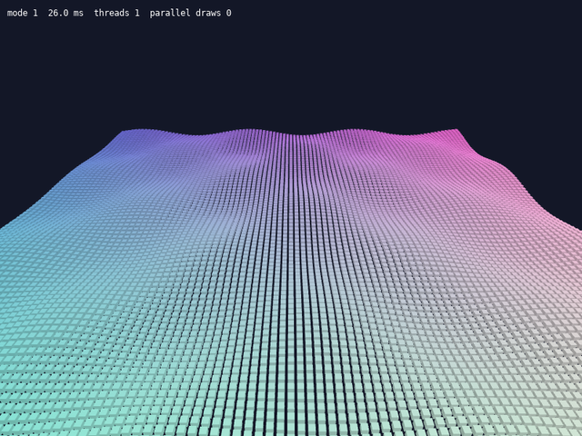

# Lesson 4 (3D): Many objects and threads

[← Tutorial index](README.md) · Previous: [Models and a HUD](3d-03-models-and-hud.md)

**Goal:** draw thousands of objects, see how simlib records them on several CPU cores on Vulkan and Direct3D 12, and learn when to fill your own draw lists on worker threads.



## The idea

- Each `sl::draw_mesh()` call costs a little CPU time: simlib prepares the draw and the graphics API records a command for it. With a few hundred objects you will never notice. With tens of thousands, the CPU can become the bottleneck rather than the GPU.
- **Vulkan and Direct3D 12 can record commands on several threads at once.** simlib does this for you: once a run of mesh draws is large enough, the rest are queued, split between worker threads, and submitted in the original order. The picture is identical and your code does not change. It is on by default.
- **OpenGL cannot**, because a GL context belongs to one thread. The settings are accepted and ignored there.
- If your own per-object work is heavy (culling, animation, matrix maths), you can do that on worker threads too. Each thread fills a `sl::RenderQueue3D`, a plain list of draws that touches no graphics state. The main thread then calls `sl::submit_render_queue()`, which issues the draws in order.
- The rule: **only the main thread calls graphics functions** (`draw_mesh`, `begin_surface_3d`, `submit_render_queue`...). Worker threads only fill queues.

## The program

```cpp
#include "sl.h"

#include <cmath>
#include <thread>
#include <vector>

constexpr int side = 100;       // 100 x 100 = 10,000 cubes
constexpr int workers = 4;

// Position and colour of cube `i` at `time`. Pure maths, so it is safe on any thread.
void describe(int i, float time, glm::mat4 &model, sl::Material &material)
{
    const int x = i % side, z = i / side;
    const float y = std::sin(x * 0.2f + time) * std::cos(z * 0.2f + time);
    model = sl::model_matrix({(x - side / 2) * 1.0f, y, (z - side / 2) * 1.0f}, {0, 0, 0});
    material.tint = {static_cast<std::uint8_t>(110 + 140 * x / side),
                     static_cast<std::uint8_t>(110 + 140 * z / side), 220, 255};
}

int main(int argc, char *argv[])
{
    if (!sl::configure_graphics_backend_from_args(argc, argv) ||
        !sl::set_gfx_mode(sl::GFX_AUTODETECT_WINDOWED, 800, 600))
    {
        return -1;
    }
    sl::set_fps(0); // uncapped, so frame time shows the difference

    sl::Surface3D *surface = sl::create_surface_3d(800, 600, 4);
    sl::Mesh *cube = sl::create_cube_mesh(0.7f);
    if (!surface || !cube)
    {
        return -1;
    }
    sl::set_light_3d({{-0.4f, -1.0f, -0.3f}, 0.7f});

    std::vector<sl::RenderQueue3D> queues(workers);
    int mode = 1; // 0 = recording off, 1 = recording on, 2 = own threads + queues
    bool running = true;
    while (running)
    {
        sl::Event event;
        while (sl::poll_event(&event))
        {
            if (event.type() == sl::Event::Type::quit ||
                (event.type() == sl::Event::Type::key_down && event.key() == sl::Event::Key::escape))
                running = false;
            else if (event.type() == sl::Event::Type::key_down && event.key() == sl::Event::Key::space)
                mode = (mode + 1) % 3;
            sl::display_handle_event(event);
        }

        sl::set_parallel_recording(mode != 0);
        const float time = static_cast<float>(sl::time_ms()) * 0.001f;
        sl::Camera camera;
        camera.position = {0.0f, 35.0f, 60.0f};
        camera.target = {0.0f, 0.0f, 0.0f};

        if (sl::begin_surface_3d(surface, camera))
        {
            sl::clear_surface_3d({20, 24, 40});
            if (mode < 2)
            {
                for (int i = 0; i < side * side; ++i)
                {
                    glm::mat4 model;
                    sl::Material material;
                    describe(i, time, model, material);
                    sl::draw_mesh(cube, model, material);
                }
            }
            else
            {
                std::vector<std::thread> threads;
                for (int w = 0; w < workers; ++w)
                    threads.emplace_back([&, w] {
                        queues[w].clear();
                        for (int i = w * side * side / workers; i < (w + 1) * side * side / workers; ++i)
                        {
                            glm::mat4 model;
                            sl::Material material;
                            describe(i, time, model, material);
                            queues[w].draw_mesh(cube, model, material);
                        }
                    });
                for (std::thread &t : threads)
                    t.join();
                for (const sl::RenderQueue3D &queue : queues)
                    sl::submit_render_queue(queue);
            }
            sl::end_surface_3d();
        }

        const sl::FrameStats stats = sl::get_frame_stats();
        sl::clear_to_colour(sl::screen, {0, 0, 0});
        sl::draw_sprite(sl::surface_3d_bitmap(surface), 0.0f, 0.0f);
        sl::gprintf(10, 10, {255, 255, 255}, "mode %d  %.1f ms  threads %u  parallel draws %u",
                    mode, stats.frame_time_ms, stats.recording_threads, stats.parallel_draws);
        sl::show_video_bitmap();
        sl::end_frame();
    }

    sl::wait_for_graphics();
    sl::destroy_mesh(cube);
    sl::destroy_surface_3d(surface);
    sl::shutdown();
    return 0;
}
```

Run it as `./lesson --vulkan` and press Space to cycle the modes.

## What just happened

- Mode 0 turns recording off, so one thread records every draw. Mode 1 is the default behaviour: after the first few hundred draws, the rest are recorded in parallel. `stats.recording_threads` shows how many threads were used and `stats.parallel_draws` how many draws they recorded.
- Mode 2 also moves the per-cube maths onto four threads. Each thread owns one queue, so no locking is needed. The queues are submitted in order, so the cubes draw in the same order as mode 1.
- On OpenGL, `recording_threads` stays at 1 in every mode. Mode 2 still works and still moves your maths onto threads, but recording stays on one thread.
- Submitting a queue still prepares each draw on the main thread, including texture uploads. Queues therefore help most when your own per-object work is the expensive part.

## Try it

1. Change `side` to 40 (1,600 cubes) and compare the frame times. Small scenes gain little.
2. Call `sl::set_parallel_recording_threshold(2000)` and watch `parallel draws` drop.
3. Add a visibility check in `describe` and skip cubes behind the camera. Cull them in the worker, so the main thread never sees them.
4. Replace the thousands of identical cubes with one `sl::draw_mesh_instanced()` call. For identical objects that is cheaper than any amount of threading.

## Go further

- Example: [`exparallel`](../examples/exparallel.md). Reference: [Parallel command recording](../renderers.md#parallel-command-recording), [3D Surfaces](../api_reference.md#3d-surfaces-includesurface3dh).
- Related: [`exinstancing`](../examples/exinstancing.md) for the instancing alternative.
- Next: [Local lights and shadows](3d-05-local-lights-and-shadows.md), then the [Physics bodies](sim-01-physics-bodies.md) track.
