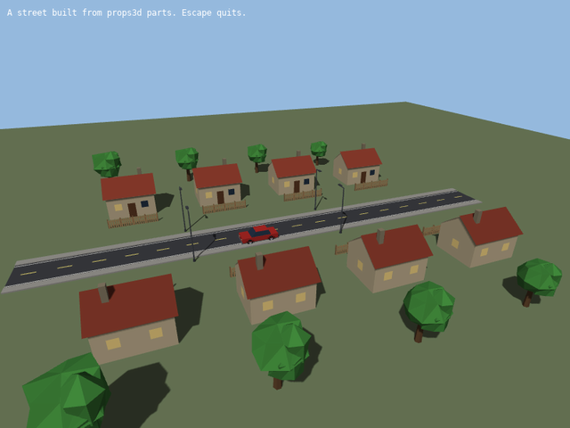

# Lesson 6 (3D): Building a scene from parts

[← Tutorial index](README.md) · Previous: [Local lights and shadows](3d-05-local-lights-and-shadows.md)

**Goal:** dress a street with houses, fences, trees, lamps and a car from the built-in props library, drawing each kind of part with a single call.



## The idea

- `props3d.h` builds low-poly scenery in code: `make_house_data()`, `make_fence_data()`, `make_tree_data()`, `make_car_data()` and about twenty more. There are no model files.
- Each builder returns **`MeshData`**: plain vertices and indices on the CPU. Colours live in the vertex colours, so a default material draws them.
- Every part stands on `y = 0`, is centred on x and z, and has its front facing **+Z**. That makes placing them simple: pick a ground position and a direction.
- Parameters are sizes and colours, and `seed` varies colours and which windows are lit. Same arguments, same part.
- To draw many copies, list where they go as `Instance3D` (`position`, `yaw`, `scale`, `tint`) and call **`bake_instances(data, instances)`**. It merges the copies into one `Mesh`, so a whole street of houses is one draw.
- `yaw` rotates about up and turns the front of the part toward `(sin yaw, cos yaw)` on the ground. Yaw 0 faces +Z, `pi/2` faces +X and `-pi/2` faces -X.

## The program

```cpp
#include "sl.h"

#include <cmath>
#include <vector>

int main(int argc, char *argv[])
{
    if (!sl::configure_graphics_backend_from_args(argc, argv) ||
        !sl::set_gfx_mode(sl::GFX_AUTODETECT_WINDOWED, 800, 600))
    {
        return -1;
    }
    sl::set_fps(60);

    sl::Surface3D *surface = sl::create_surface_3d(800, 600, 4);
    sl::Mesh *ground = sl::create_plane_mesh(160.0f, 160.0f, {116, 132, 96});
    sl::ShadowMap3D *shadows = sl::create_shadow_map_3d(2048);
    if (!surface || !ground || !shadows)
    {
        return -1;
    }

    // Where each kind of part goes. Parts facing the road turn by +-90 degrees.
    const float quarter_turn = 1.5707963f;
    std::vector<sl::Instance3D> road_spots, house_spots, fence_spots, tree_spots, lamp_spots;
    for (int i = 0; i < 6; ++i)
    {
        road_spots.push_back({{0.0f, 0.0f, -25.0f + 10.0f * static_cast<float>(i)}});
    }
    for (int i = 0; i < 4; ++i)
    {
        const float z = -18.0f + 12.0f * static_cast<float>(i);
        for (const float side : {-1.0f, 1.0f})
        {
            house_spots.push_back({{side * 13.0f, 0.0f, z}, -side * quarter_turn});
            fence_spots.push_back({{side * 8.0f, 0.0f, z}, quarter_turn});
            tree_spots.push_back({{side * 22.0f, 0.0f, z + 3.0f}, 0.0f, 0.8f + 0.1f * static_cast<float>(i)});
        }
    }
    for (const float side : {-1.0f, 1.0f})
    {
        lamp_spots.push_back({{side * 3.7f, 0.0f, -6.0f}, -side * quarter_turn});
        lamp_spots.push_back({{side * 3.7f, 0.0f, 12.0f}, -side * quarter_turn});
    }

    // Build each part once, then merge all its copies into one mesh.
    sl::Mesh *roads = sl::bake_instances(sl::make_road_data(10.0f, 6.0f), road_spots);
    sl::Mesh *houses = sl::bake_instances(sl::make_house_data(), house_spots);
    sl::Mesh *fences = sl::bake_instances(sl::make_fence_data(), fence_spots);
    sl::Mesh *trees = sl::bake_instances(sl::make_tree_data(), tree_spots);
    sl::Mesh *lamps = sl::bake_instances(sl::make_street_lamp_data(), lamp_spots);
    sl::Mesh *car = sl::bake_instances(sl::make_car_data(4.4f, {190, 44, 40}), {{{1.5f, 0.0f, 4.0f}}});
    sl::Mesh *parts[] = {roads, houses, fences, trees, lamps, car};

    bool running = true;
    while (running)
    {
        sl::Event event;
        while (sl::poll_event(&event))
        {
            if (event.type() == sl::Event::Type::quit ||
                (event.type() == sl::Event::Type::key_down && event.key() == sl::Event::Key::escape))
                running = false;
            sl::display_handle_event(event);
        }

        const float time = static_cast<float>(sl::time_ms()) * 0.001f;

        sl::Light3D sun;
        sun.direction = {-0.5f, -0.75f, -0.4f};
        sun.ambient = 0.35f;
        sl::set_light_3d(sun);

        auto draw_scene = [&]()
        {
            sl::draw_mesh(ground, sl::model_matrix({0, 0, 0}, {0, 0, 0}));
            for (const sl::Mesh *part : parts)
            {
                sl::draw_mesh(part, sl::model_matrix({0, 0, 0}, {0, 0, 0}));
            }
        };

        sl::set_shadow_map_3d(nullptr);
        if (sl::begin_shadow_pass_3d(shadows, {0.0f, 0.0f, 0.0f}, 40.0f))
        {
            draw_scene();
            sl::end_shadow_pass_3d();
            sl::set_shadow_map_3d(shadows);
        }

        sl::Camera camera;
        camera.position = {std::sin(time * 0.2f) * 42.0f, 22.0f, std::cos(time * 0.2f) * 42.0f};
        camera.target = {0.0f, 2.0f, 0.0f};
        if (sl::begin_surface_3d(surface, camera))
        {
            sl::clear_surface_3d({150, 186, 222});
            draw_scene();
            sl::end_surface_3d();
        }

        sl::clear_to_colour(sl::screen, {0, 0, 0});
        sl::draw_sprite(sl::surface_3d_bitmap(surface), 0.0f, 0.0f);
        sl::gprintf(10, 10, {255, 255, 255}, "A street built from props3d parts. Escape quits.");
        sl::show_video_bitmap();
        sl::end_frame();
    }

    sl::wait_for_graphics();
    sl::set_shadow_map_3d(nullptr);
    for (sl::Mesh *part : parts)
    {
        sl::destroy_mesh(part);
    }
    sl::destroy_mesh(ground);
    sl::destroy_shadow_map_3d(shadows);
    sl::destroy_surface_3d(surface);
    sl::shutdown();
    return 0;
}
```

## What just happened

- Each `make_*_data()` call builds one part. `bake_instances` copies it to every `Instance3D`, applying the position, yaw, scale and tint, and uploads one `Mesh`. Six draw calls draw the whole street (plus the ground).
- `Instance3D` is an aggregate, so `{{x, y, z}, yaw, scale}` fills it in order; anything left out keeps its default (yaw 0, scale 1, no tint).
- The houses sit at `x = +-13`. A house on the left (`side = -1`) gets `yaw = +pi/2` so its door faces +X, toward the road. The fences are along X by default, so a quarter turn lays them along the street.
- The road runs along Z, unlike the fence and wall, which run along X. The [API reference](../api_reference.md#3d-props-includeprops3dh) lists the direction of every part.
- Parts are ordinary opaque lit meshes, so they cast and receive the sun shadow from the shadow map like any other mesh. Windows are baked into vertex colours, so they do not glow, but they do give the buildings some life.
- `bake_instances` does not keep the `MeshData`, so keep it if you want to bake again, for example with different placements.
- The pole of a street lamp ends in a warm glowing quad underneath the head, at `(0, 6, 0.9)` in its own space. That is where to put a `LocalLight3D` for a night scene (see [lesson 5](3d-05-local-lights-and-shadows.md)); [`extown`](../examples/extown.md) does it.

## Try it

1. Change the house colours: `make_house_data(6, 5, 3, {190, 200, 210}, {70, 84, 110}, 2)`.
2. Pass a different `tint` in an `Instance3D` to colour some trees differently: `{{x, 0, z}, 0.0f, 1.0f, {255, 200, 160, 255}}`.
3. Add a `make_office_data()` and a `make_skyscraper_data()` at the end of the street.
4. Merge two parts with `append_mesh_data(a, b)` (for example a house and its fence) and bake the combination as one part.
5. Add `make_radar_data()`, `make_control_tower_data()` and `make_aeroplane_data()` for an airfield.
6. Add a night light on each lamp, using the position noted above.

## Go further

- Examples: [`exprops`](../examples/exprops.md) (every part in a lit gallery), [`extown`](../examples/extown.md) (a town and airfield). API: [3D props](../api_reference.md#3d-props-includeprops3dh) and [Clutter](../api_reference.md#atmosphere--clutter-includeatmosphereh-includeclutterh).
- Next track: [Physics bodies](sim-01-physics-bodies.md).
