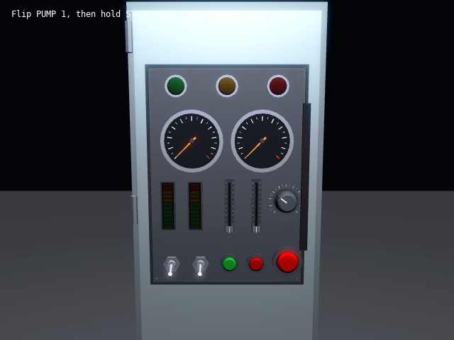

# Lesson 7 (3D): A clickable 3D panel

[← Tutorial index](README.md) · Previous: [Building a scene from parts](3d-06-building-a-scene-from-parts.md)

**Goal:** put a factory control cabinet in a 3D scene, operate its switches and buttons with the mouse, and let its lamps glow and light the cabinet.



## The idea

- The panel model from [lesson 5](2d-05-control-panels.md) is reused as it is. Only the drawing changes: **`ControlPanelView3D`** turns a `ControlPanel` into meshes (dial faces, knobs, toggles, buttons, lamps, sliders, meter segments), built once from the parts in `props3d.h`.
- `sl::make_control_cabinet()` (and `make_cockpit()`) return a **`ControlAssembly`**: a `panel`, a `body` mesh to draw around it and a `panel_pose`, the matrix that puts the panel on the body. One panel unit is `assembly.unit` metres (0.002 by default).
- `view.draw(panel, pose)` draws the current state. Needles turn, toggles tilt, buttons sink, and every frame reflects the values you set.
- **Mouse picking:** `view.pick(camera, w, h, mouse_x, mouse_y, pose, &pointer)` casts a ray from the mouse through the camera onto the panel's plane and fills in a `Pointer` in panel units. Set `pointer.down` yourself and call `panel.update(dt, pointer)`, exactly as in 2D.
- **Glow:** lamps, lit meter segments and latched buttons are *emissive* with values above 1. Drawn through **`Hdr`**, those bloom. `view.lights(panel, pose)` also returns a small `LocalLight3D` for each lit lamp, so a red warning lamp tints the metal near it.

## The program

```cpp
#include "sl.h"

#include <algorithm>
#include <cmath>
#include <cstdio>
#include <vector>

int main(int argc, char **argv)
{
    if (!sl::configure_graphics_backend_from_args(argc, argv))
        return 1;
    constexpr int w = 640, h = 480;
    if (!sl::set_gfx_mode(sl::GFX_AUTODETECT_WINDOWED, w, h))
    {
        std::fprintf(stderr, "Graphics failed: %s\n", sl::last_error().c_str());
        return 1;
    }
    sl::set_window_title("Lesson 7: a clickable 3D panel");
    sl::set_fps(60);
    sl::Surface3D *surface = sl::create_surface_3d(w, h, 4);
    sl::Hdr hdr;
    if (!surface || !hdr.initialise())
        return 1;

    sl::ControlAssembly cabinet = sl::make_control_cabinet();
    sl::ControlPanelView3D view(cabinet.panel, cabinet.unit);
    sl::Mesh *body = sl::create_mesh(cabinet.body.vertices, cabinet.body.indices);
    sl::Mesh *floor = sl::create_plane_mesh(12.0f, 12.0f, {70, 72, 78, 255});
    const int pump = cabinet.panel.find("PUMP 1");
    const int start = cabinet.panel.find("START");
    const int pressure = cabinet.panel.find("PRESSURE");
    const int run = cabinet.panel.find("RUN");

    sl::Camera camera;
    camera.position = {0.0f, 1.45f, 1.9f};
    camera.target = {0.0f, 1.2f, 0.0f};
    camera.field_of_view = 45.0f;
    camera.near_plane = 0.05f;
    const glm::mat4 panel_world = cabinet.panel_pose;

    float level = 0.0f;
    bool running = true;
    std::uint32_t last = sl::time_ms();
    while (running)
    {
        const std::uint32_t now = sl::time_ms();
        const float dt = std::clamp((now - last) * 0.001f, 0.001f, 0.1f);
        last = now;
        sl::Event event;
        while (sl::poll_event(&event))
        {
            if (event.type() == sl::Event::Type::quit ||
                (event.type() == sl::Event::Type::key_down && event.key() == sl::Event::Key::escape))
                running = false;
            sl::display_handle_event(event);
        }

        // Turn the mouse into a ray, find where it meets the panel, and hand that to the panel as a pointer.
        sl::Pointer pointer;
        if (view.pick(camera, w, h, static_cast<float>(sl::mouse_x()), static_cast<float>(sl::mouse_y()), panel_world, &pointer))
        {
            pointer.down = sl::mouse_button_down(sl::MouseButton::left);
            cabinet.panel.update(dt, pointer);
        }
        const bool going = cabinet.panel.on(pump) && cabinet.panel.on(start);
        level += ((going ? 8.0f : 0.0f) - level) * std::min(1.0f, 1.5f * dt);
        cabinet.panel.set_value(pressure, level);
        cabinet.panel.set_on(run, going);

        // Every lit lamp becomes a small local light, so the glow falls on the panel and the cabinet.
        std::vector<sl::LocalLight3D> lights = view.lights(cabinet.panel, panel_world);
        sl::LocalLight3D lamp;
        lamp.position = {0.0f, 2.4f, 1.2f};
        lamp.intensity = 4.0f;
        lamp.range = 7.0f;
        lights.push_back(lamp);
        sl::Light3D ambient;
        ambient.ambient = 0.06f;
        sl::set_light_3d(ambient);
        sl::set_local_lights_3d(lights);
        hdr.set_bloom_threshold(1.6f);

        if (sl::begin_surface_3d(surface, camera))
        {
            sl::clear_surface_3d({4, 5, 9, 255});
            sl::draw_mesh(floor, glm::mat4(1.0f));
            sl::draw_mesh(body, glm::mat4(1.0f));
            view.draw(cabinet.panel, panel_world);
            sl::end_surface_3d();
        }
        hdr.apply(sl::surface_3d_bitmap(surface), 0, 0, w, h);
        sl::gprintf(16, 12, {255, 255, 255}, "Flip PUMP 1, then hold START");
        sl::show_video_bitmap();
        sl::end_frame();
    }
    sl::wait_for_graphics();
    hdr.shutdown();
    sl::destroy_mesh(body);
    sl::destroy_mesh(floor);
    sl::destroy_surface_3d(surface);
    sl::shutdown();
    return 0;
}
```

## What just happened

- The panel's world pose is `cabinet.panel_pose` because the cabinet sits at the origin. For a cabinet moved by a `model` matrix, use `model * cabinet.panel_pose` for `draw`, `lights` and `pick`.
- `pick` returns false only if the ray misses the panel's plane (for example, the camera looks away). It fills in `x` and `y` even outside the panel, and the panel ignores a pointer that is not over a control. When two panels are in view, give `update` the pointer only of the one under the mouse, as [`excockpit`](../examples/excockpit.md) does.
- Moving parts are separate meshes drawn with their own transforms each frame, while the dial faces, tracks and the back plate are baked once. So drawing a whole panel is cheap.
- The `Hdr` bloom threshold of 1.6 is above anything a lit surface reaches, so only the emissive parts glow. See [`exhdr`](../examples/exhdr.md) for the tonemapping controls.
- `ControlPanelView3D` owns its meshes and cannot be copied. Keep it alive while you draw, and destroy it before shutting down the graphics.
- `screen_ray(camera, w, h, x, y)` in `scene3d.h` is the ray maths used by `pick`. Use it for your own picking.

## Try it

1. Move the cabinet: `model = translate({1, 0, 0}) * rotate(0.4, {0, 1, 0})` and pass `model * panel_pose` everywhere.
2. Press and drag the SPEED knob and the VALVE sliders. Watch the pressure needle.
3. Call `sl::make_cockpit()` instead and put the camera behind the seat, looking at the panel.
4. Raise `LocalLight3D::intensity` through `view.lights(panel, pose, 0.3f, 1.5f)` for stronger lamp light.
5. Build your own panel: `sl::ControlPanel p(300, 200); p.add_knob(...)`, a `ControlPanelView3D` for it, and any `pose` you like.

## Go further

- Examples: [`excockpit`](../examples/excockpit.md) (cockpit and cabinet in one scene with three cameras), [`excontrols`](../examples/excontrols.md) (the same panels in 2D). API: [Control panels](../api_reference.md#control-panels-includecontrolsh) and [3D props](../api_reference.md#3d-props-includeprops3dh) for the individual dial, knob and lamp meshes.
- Next: [Terrain and sky](3d-08-terrain-and-sky.md), then the next track: [Physics bodies](sim-01-physics-bodies.md).
