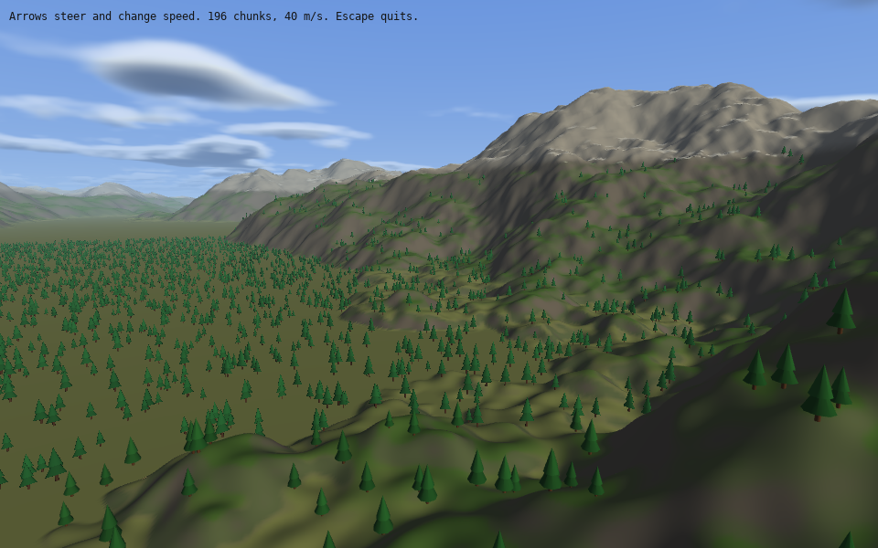

# Lesson 8 (3D): Terrain and sky

[← Tutorial index](README.md) · Previous: [A clickable 3D panel](3d-07-a-clickable-3d-panel.md)

**Goal:** fly over a 16 km landscape of mountains and pine forests under a volumetric cloud sky, with detail that loads around you as you go.



## The idea

- A `Terrain` is **chunked level-of-detail** ground: fine triangles near the eye, coarse ones far away. You describe the land with a **height source** (here a `NoiseSource`, made of seeded noise) and a `TerrainConfig`, then call `terrain.update(view)` each frame to tell it where you are.
- A `ClutterLayer` scatters meshes (trees, rocks) over the terrain as cheap instances. Each `ClutterSpecies` says where it may grow: a `density`, height and slope limits, and a `suitability` function for anything custom.
- `Environment3D` supplies the sky, sun, fog and clouds in one struct.
- Large worlds lose float precision far from the origin. So the camera stays at `(0, 0, 0)`, and `terrain.draw(position)` and `clutter.draw(position)` are told where the eye really is and draw everything relative to it. World positions stay in `double`s (`dvec3`).
- **Always call `clear_surface_3d` each frame.** Without it the depth buffer from the previous frame survives and the picture shears and smears.

## The program

```cpp
#include "sl.h"

#include <algorithm>
#include <cmath>
#include <memory>

int main(int argc, char *argv[])
{
    if (!sl::configure_graphics_backend_from_args(argc, argv) ||
        !sl::set_gfx_mode(sl::GFX_AUTODETECT_WINDOWED, 960, 600))
    {
        return -1;
    }
    sl::set_fps(60);
    sl::Surface3D *surface = sl::create_surface_3d(960, 600, 4);
    if (!surface)
        return -1;

    // 1. The shape of the land. A NoiseSource makes endless hills from a seed.
    sl::NoiseParameters noise;
    noise.seed = 7;
    noise.frequency = 1.0 / 3000.0; // one feature every few kilometres
    noise.amplitude = 220.0;        // metres from valley to peak
    noise.floor_height = 0.0;       // flatten everything below 0 into lowlands

    // 2. How it is drawn: a 16 km square, coloured by height and slope.
    sl::TerrainConfig config;
    config.size = 16384.0;
    config.origin = {-8192.0, 0.0, -8192.0};
    config.finest_cell_size = 1.0;
    config.layers = sl::default_terrain_layers(0.0, 220.0);
    sl::Terrain terrain(config, std::make_shared<sl::NoiseSource>(noise));

    // 3. Trees scattered on the land. They are drawn as cheap instances and fade out with distance.
    sl::ClutterLayer clutter(terrain);
    sl::ClutterSpecies pines;
    pines.mesh = sl::make_conifer_data(9.0f, 2.2f);
    pines.density = 0.004f;      // trees per square metre, before suitability
    pines.max_height = 160.0f;   // no trees above the tree line
    pines.max_slope = 30.0f;     // none on steep slopes
    pines.min_scale = 0.7f;
    pines.max_scale = 1.4f;
    pines.near_distance = 220.0f;
    pines.far_distance = 1400.0f;
    pines.suitability = [](const sl::TerrainSample &s)
    { return static_cast<float>(std::clamp(1.0 - s.height / 160.0, 0.1, 1.0)); }; // sparser higher up
    clutter.add_species(pines);

    sl::dvec3 position{0.0, 0.0, 0.0};
    double heading = 0.0;
    double speed = 40.0; // metres per second

    bool running = true;
    while (running)
    {
        sl::Event event;
        while (sl::poll_event(&event))
        {
            if (event.type() == sl::Event::Type::quit ||
                (event.type() == sl::Event::Type::key_down && event.key() == sl::Event::Key::escape))
                running = false;
            sl::display_handle_event(event);
        }
        const double dt = std::min(0.05, sl::get_frame_time() / 1000.0);

        // Fly forwards, steering with the arrow keys, always 70 m above the highest ground ahead.
        if (sl::key_down(sl::Key::arrow_left))
            heading -= dt;
        if (sl::key_down(sl::Key::arrow_right))
            heading += dt;
        if (sl::key_down(sl::Key::arrow_up))
            speed = std::min(speed + 40.0 * dt, 300.0);
        if (sl::key_down(sl::Key::arrow_down))
            speed = std::max(speed - 40.0 * dt, 5.0);
        const sl::dvec3 forward{std::sin(heading), -0.15, -std::cos(heading)};
        position.x += forward.x * speed * dt;
        position.z += forward.z * speed * dt;
        double ground = terrain.height_at(position.x, position.z);
        for (int i = 1; i <= 4; ++i) // look ahead so hills never rush up at us
            ground = std::max(ground, terrain.height_at(position.x + forward.x * 60.0 * i, position.z + forward.z * 60.0 * i));
        position.y = ground + 70.0;

        // 4. Tell the terrain where the eye is so it can load detail near it and coarse chunks far away.
        sl::TerrainView view;
        view.position = position;
        view.forward = glm::normalize(forward);
        view.up = {0.0, 1.0, 0.0};
        view.fov_y_degrees = 60.0;
        view.aspect = 960.0 / 600.0;
        view.viewport_height = 600.0;
        view.far_distance = 30000.0;
        terrain.update(view);
        clutter.update(view);

        // The camera stays at the origin and the world is drawn relative to it, so floats stay precise.
        sl::Camera camera;
        camera.position = glm::vec3(0.0f);
        camera.target = glm::vec3(view.forward);
        camera.up = glm::vec3(0.0f, 1.0f, 0.0f);
        camera.field_of_view = 60.0f;
        camera.near_plane = 0.5f;
        camera.far_plane = static_cast<float>(view.far_distance);

        // 5. Sky, sun, fog and clouds all come from one Environment3D.
        sl::Environment3D sky;
        sky.sun_direction = glm::normalize(glm::vec3(-0.5f, -0.4f, -0.6f)); // the direction the light travels
        sky.up = glm::vec3(0.0f, 1.0f, 0.0f);
        sky.camera_position = position;
        sky.camera_altitude = static_cast<float>(position.y - terrain.height_at(position.x, position.z));
        sky.time = static_cast<double>(sl::time_ms()) * 0.001;
        sky.fog_enabled = true;
        sky.fog_density = 1.4e-4f;
        sky.clouds.enabled = true;
        sky.clouds.volumetric = true;

        if (sl::begin_surface_3d(surface, camera))
        {
            sl::clear_surface_3d({150, 185, 230, 255});
            sl::set_environment_3d(sky);
            sl::draw_sky_3d();

            sl::Light3D sun;
            sun.direction = sky.sun_direction;
            sun.colour = sl::atmosphere_sun_colour(sky); // warmer when the sun is low
            sun.ambient = 0.3f;
            sl::set_light_3d(sun);

            terrain.draw(position);
            clutter.draw(position);
            sl::end_surface_3d();
        }

        sl::clear_to_colour(sl::screen, {0, 0, 0});
        sl::draw_sprite(sl::surface_3d_bitmap(surface), 0.0f, 0.0f);
        sl::gprintf(10, 10, {20, 20, 20}, "Arrows steer and change speed. %d chunks, %.0f m/s. Escape quits.",
                    terrain.stats().visible_chunks, speed);
        sl::show_video_bitmap();
        sl::end_frame();
    }

    sl::wait_for_graphics();
    sl::clear_environment_3d();
    sl::destroy_surface_3d(surface);
    return 0;
}
```

## What just happened

1. **`NoiseParameters`** define the land: `frequency` sets feature size, `amplitude` the height range, `floor_height` flattens valleys. Change `seed` for a different world.
2. **`TerrainConfig`** sets the area and the finest detail. `default_terrain_layers` colours the ground by height and slope (grass, rock, snow).
3. **`ClutterSpecies`** says where trees grow. `density` is the starting count, then height, slope and `suitability` thin it out. `near_distance` and `far_distance` control fade-out.
4. **`TerrainView`** is the eye as the terrain sees it. Chunks close to it get refined, the rest stay coarse; both `terrain` and `clutter` update from the same view.
5. **`terrain.height_at(x, z)`** answers "how high is the ground here?" at any point. The program uses it to keep the aircraft above the hills.
6. **`Environment3D`** feeds the sky, fog and volumetric clouds. `atmosphere_sun_colour` gives a sun colour that warms as the sun gets lower.

## Try it

1. Change `noise.seed`, then `noise.amplitude` to 500 for alpine peaks.
2. Raise `pines.density` to `0.01` and lower `far_distance` to keep the frame rate.
3. Add a second species, with `mesh = sl::make_rock_data(2.0f)`, `min_height` 100 and a small `density` such as `0.0005`. (Props need `#include "props3d.h"` if `sl.h` does not already pull it in.)
4. Move `sun_direction` closer to horizontal and watch the sky and sun colour change.
5. Set `sky.clouds.volumetric = false` for cheaper flat clouds.
6. Turn off `fog_enabled` to see how much the fog hides the far chunks' coarseness.

## Go further

- Example: [`exterrain`](../examples/exterrain.md) (the full version with a flight camera and more layers). Guide: [Terrain](../terrain.md). API: [Chunked-LOD terrain](../api_reference.md#chunked-lod-terrain-includeterrainh).
- Next: [Voxel worlds](3d-09-voxel-worlds.md).
