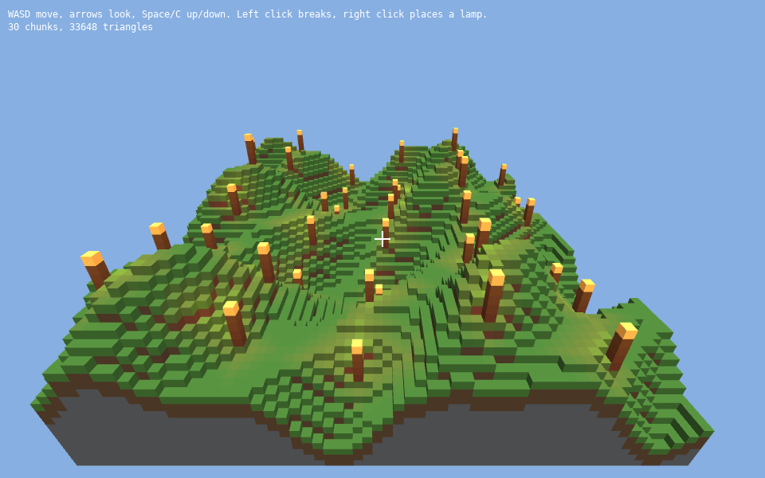

# Lesson 9 (3D): Voxel worlds

[← Tutorial index](README.md) · Previous: [Terrain and sky](3d-08-terrain-and-sky.md)

**Goal:** build a block world from code, fly around it, and break blocks or place glowing lamps with the mouse.



## The idea

- A `VoxelWorld` is an endless grid of **blocks**. Each block is one byte (`BlockId`); `0` (`BLOCK_AIR`) is empty. You set blocks with `set_block(x, y, z, id)`.
- The world is split into **chunks**. Only chunks whose blocks changed are rebuilt, by `update_dirty_chunks()`, and only visible faces are meshed, so big worlds stay cheap.
- Block types are registered with `register_block_definition`. With no texture atlas a block is drawn in its `tint`. A block with `light_emission` above 0 is a light source: `update_lighting()` spreads its light through nearby air.
- `world.raycast(origin, direction, max_distance)` finds the first block along a ray. The result gives the block that was hit (`hit_block`) and the empty cell in front of it (`place_block`), which is just what a break/place tool needs.

## The program

```cpp
#include "sl.h"
#include "voxel.h"

#include <algorithm>
#include <cmath>

namespace
{
    enum Block : sl::BlockId { grass = 1, dirt, stone, glow, wood };

    void define(sl::BlockId id, sl::Colour tint, std::uint8_t emission = 0)
    {
        sl::BlockDefinition def;
        def.tint = tint;
        def.light_emission = emission;
        def.light_colour = {255, 190, 110, 255};
        sl::register_block_definition(id, def);
    }
}

int main(int argc, char *argv[])
{
    if (!sl::configure_graphics_backend_from_args(argc, argv) ||
        !sl::set_gfx_mode(sl::GFX_AUTODETECT_WINDOWED, 960, 600))
    {
        return -1;
    }
    sl::set_fps(60);
    sl::Surface3D *view = sl::create_surface_3d(960, 600, 4);
    if (!view)
        return -1;

    // 1. Block types: with no atlas, each block is drawn in its tint. Emissive blocks light their surroundings.
    define(grass, {96, 160, 70, 255});
    define(dirt, {126, 92, 62, 255});
    define(stone, {128, 130, 134, 255});
    define(glow, {255, 210, 120, 255}, 14);
    define(wood, {110, 78, 48, 255});

    // 2. Fill a world: rolling hills of grass over dirt and stone, a few tree trunks, a glowing lamp.
    sl::VoxelWorld world;
    const int size = 64;
    for (int x = 0; x < size; ++x)
    {
        for (int z = 0; z < size; ++z)
        {
            const int height = 10 + static_cast<int>(5.0f * std::sin(x * 0.18f) + 4.0f * std::cos(z * 0.23f) +
                                                     2.0f * std::sin((x + z) * 0.4f));
            for (int y = 0; y <= height; ++y)
                world.set_block(x, y, z, y == height ? grass : (y > height - 3 ? dirt : stone));
            if ((x * 7 + z * 13) % 97 == 0)
            {
                for (int y = height + 1; y <= height + 4; ++y)
                    world.set_block(x, y, z, wood);
                world.set_block(x, height + 5, z, glow);
            }
        }
    }
    world.update_lighting();

    glm::vec3 position(32.0f, 38.0f, 84.0f);
    float yaw = 0.0f, pitch = -0.5f;
    bool was_left = false, was_right = false;

    bool running = true;
    while (running)
    {
        sl::Event event;
        while (sl::poll_event(&event))
        {
            if (event.type() == sl::Event::Type::quit ||
                (event.type() == sl::Event::Type::key_down && event.key() == sl::Event::Key::escape))
                running = false;
            sl::display_handle_event(event);
        }
        const float dt = std::min(0.05f, static_cast<float>(sl::get_frame_time()) / 1000.0f);

        // Arrow keys turn; WASD moves along the view direction; Space and C go up and down.
        if (sl::key_down(sl::Key::arrow_left))
            yaw -= 1.6f * dt;
        if (sl::key_down(sl::Key::arrow_right))
            yaw += 1.6f * dt;
        if (sl::key_down(sl::Key::arrow_up))
            pitch = std::min(pitch + 1.2f * dt, 1.4f);
        if (sl::key_down(sl::Key::arrow_down))
            pitch = std::max(pitch - 1.2f * dt, -1.4f);
        const glm::vec3 forward(std::sin(yaw) * std::cos(pitch), std::sin(pitch), -std::cos(yaw) * std::cos(pitch));
        const glm::vec3 right(std::cos(yaw), 0.0f, std::sin(yaw));
        glm::vec3 move(0.0f);
        if (sl::key_down(sl::Key::letter_w))
            move += forward;
        if (sl::key_down(sl::Key::letter_s))
            move -= forward;
        if (sl::key_down(sl::Key::letter_d))
            move += right;
        if (sl::key_down(sl::Key::letter_a))
            move -= right;
        if (sl::key_down(sl::Key::space))
            move.y += 1.0f;
        if (sl::key_down(sl::Key::letter_c))
            move.y -= 1.0f;
        position += move * 10.0f * dt;

        // 3. Ask the world what the centre of the screen is looking at: break it, or place a block against it.
        const sl::VoxelRaycastResult target = world.raycast(position, glm::normalize(forward), 12.0f);
        const bool left = sl::mouse_button_down(sl::MouseButton::left);
        const bool right_button = sl::mouse_button_down(sl::MouseButton::right);
        bool changed = false;
        if (target.hit && left && !was_left)
            changed = world.set_block(target.hit_block.x, target.hit_block.y, target.hit_block.z, sl::BLOCK_AIR);
        if (target.hit && right_button && !was_right)
            changed = world.set_block(target.place_block.x, target.place_block.y, target.place_block.z, glow);
        was_left = left;
        was_right = right_button;
        if (changed)
            world.update_lighting(); // spreads or removes light after the edit

        world.update_dirty_chunks(); // rebuilds only the chunk meshes that changed

        sl::Camera camera;
        camera.position = position;
        camera.target = position + forward;
        camera.up = {0.0f, 1.0f, 0.0f};
        camera.field_of_view = 70.0f;
        camera.near_plane = 0.1f;
        camera.far_plane = 400.0f;

        if (sl::begin_surface_3d(view, camera))
        {
            sl::clear_surface_3d({135, 175, 225, 255});
            sl::Light3D sun;
            sun.direction = glm::normalize(glm::vec3(-0.4f, -0.8f, -0.3f));
            sun.ambient = 0.55f;
            sl::set_light_3d(sun);
            world.draw();
            sl::end_surface_3d();
        }

        sl::draw_sprite(sl::surface_3d_bitmap(view), 0.0f, 0.0f);
        sl::line(sl::screen, 470, 300, 490, 300, {255, 255, 255}, 2.0f);
        sl::line(sl::screen, 480, 290, 480, 310, {255, 255, 255}, 2.0f);
        sl::gprintf(10, 10, {255, 255, 255}, "WASD move, arrows look, Space/C up/down. Left click breaks, right click places a lamp.");
        sl::gprintf(10, 26, {255, 255, 255}, "%zu chunks, %d triangles", world.chunk_count(), world.total_triangles());
        sl::show_video_bitmap();
        sl::end_frame();
    }

    sl::wait_for_graphics();
    sl::destroy_surface_3d(view);
    return 0;
}
```

## What just happened

1. **Block definitions** give each id a colour and, for the lamp, a light level and colour.
2. **`set_block`** fills columns of stone, dirt and grass under a height function, then adds a few wood trunks capped with glow blocks. Anything outside the filled area is simply air.
3. **`update_lighting()`** floods emissive light outward. Call it after bulk edits and after each change that adds or removes a light.
4. **`raycast`** from the eye along the view direction finds the target. A left click sets `hit_block` to air; a right click puts a glow block at `place_block`. The `was_left` and `was_right` flags make each click act once.
5. **`update_dirty_chunks()`** re-meshes only the touched chunks, so editing stays fast.
6. **`world.draw()`** draws every chunk mesh with the current sun.

## Try it

1. Add a water-blue block and fill every empty cell below `y = 9` with it.
2. Cycle the placed block type with the number keys instead of always placing `glow`.
3. Make `size` 128 and watch the chunk and triangle counts in the HUD.
4. Make `light_emission` 6 and compare the glow radius.
5. Load an atlas texture and pass it to `update_dirty_chunks(atlas)` so blocks get real textures.

## Go further

- Examples: [`exvoxel`](../examples/exvoxel.md), plus the voxel showcase in the [Showcase Guide](../showcases.md). API: [Voxel chunks and world](../api_reference.md#voxel-chunks--world-includevoxelh).
- Next track: [Physics bodies](sim-01-physics-bodies.md).
