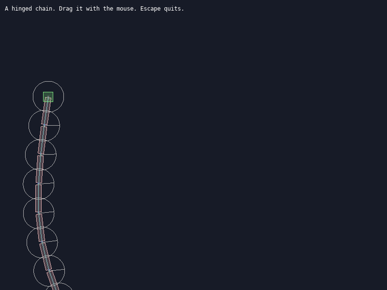

# Lesson 2 (Simulation): Joints

[← Tutorial index](README.md) · Previous: [Physics bodies](sim-01-physics-bodies.md)

**Goal:** hang a chain of planks from hinges, and grab and drag them with the mouse.



## The idea

- A **joint** constrains how two bodies move relative to each other. This lesson uses three:
  - **Revolute** (a hinge): both bodies share one pivot point and can rotate around it. Doors, pendulums, bridge planks.
  - **Distance** (a spring or rod): keeps two anchor points a set distance apart. With a frequency in Hz and damping it behaves like a spring.
  - **Mouse**: pulls a body toward a target point, so you can drag things around.
- Joint anchors are given in **world** coordinates at creation, and the bodies start in that pose.
- To grab with the mouse, find the body under the cursor with `sl::physics_query_point`, then create a mouse joint to it. Move its target every frame and destroy it on release.

## The program

```cpp
#include "sl.h"

int main(int argc, char *argv[])
{
    if (!sl::configure_graphics_backend_from_args(argc, argv) ||
        !sl::set_gfx_mode(sl::GFX_AUTODETECT_WINDOWED, 800, 600))
    {
        return -1;
    }
    sl::set_fps(60);

    sl::PhysicsWorld *world = sl::create_physics_world({0.0f, 980.0f});

    // A fixed anchor on the left, then a chain of planks hinged end to end.
    sl::PhysicsBody *post = sl::create_physics_body(world, sl::BodyType::static_body, {100.0f, 200.0f});
    sl::add_box_fixture(post, 20.0f, 20.0f, 0.0f, 0.5f, 0.0f);

    sl::PhysicsBody *previous = post;
    const float plank_length = 60.0f;
    for (int i = 0; i < 8; ++i)
    {
        const float centre_x = 100.0f + plank_length * (static_cast<float>(i) + 0.5f);
        sl::PhysicsBody *plank = sl::create_physics_body(world, sl::BodyType::dynamic_body, {centre_x, 200.0f});
        sl::add_box_fixture(plank, plank_length - 4.0f, 12.0f, 1.0f, 0.4f, 0.0f);

        // The hinge sits at the left end of this plank.
        sl::create_revolute_joint(world, previous, plank, {100.0f + plank_length * static_cast<float>(i), 200.0f});
        previous = plank;
    }

    // A heavy ball on the end, to make it swing.
    sl::PhysicsBody *ball = sl::create_physics_body(world, sl::BodyType::dynamic_body, {100.0f + plank_length * 8.0f + 20.0f, 200.0f});
    sl::add_circle_fixture(ball, 20.0f, 2.0f, 0.4f, 0.3f);
    sl::create_revolute_joint(world, previous, ball, {100.0f + plank_length * 8.0f, 200.0f});

    sl::PhysicsJoint *grab = nullptr;
    bool running = true;
    while (running)
    {
        sl::Event event;
        while (sl::poll_event(&event))
        {
            if (event.type() == sl::Event::Type::quit ||
                (event.type() == sl::Event::Type::key_down && event.key() == sl::Event::Key::escape))
                running = false;

            const sl::Vec2 mouse{static_cast<float>(sl::mouse_x()), static_cast<float>(sl::mouse_y())};
            if (event.type() == sl::Event::Type::mouse_button_down && !grab)
            {
                for (sl::PhysicsBody *body : sl::physics_query_point(world, mouse))
                {
                    if (body != post)
                    {
                        grab = sl::create_mouse_joint(world, body, mouse);
                        break;
                    }
                }
            }
            if (event.type() == sl::Event::Type::mouse_button_up && grab)
            {
                sl::destroy_physics_joint(grab);
                grab = nullptr;
            }
            sl::display_handle_event(event);
        }

        if (grab)
            sl::set_mouse_joint_target(grab, {static_cast<float>(sl::mouse_x()), static_cast<float>(sl::mouse_y())});

        sl::step_physics_world(world, 1.0f / 60.0f);

        sl::clear_to_colour(sl::screen, {24, 28, 40});
        sl::debug_draw_physics(world);
        sl::gprintf(10, 10, {255, 255, 255}, "A hinged chain. Drag it with the mouse. Escape quits.");
        sl::show_video_bitmap();
        sl::end_frame();
    }

    sl::wait_for_graphics();
    sl::destroy_physics_world(world);
    sl::shutdown();
    return 0;
}
```

## What just happened

- Each hinge is placed at the joint between two planks (a plank's left end), in world coordinates. The same point is used by both bodies, which is what keeps them connected.
- The chain is pinned to a static post, so the whole thing swings from one end.
- The mouse joint is a temporary spring: it is created on press and destroyed on release. Destroying the world also destroys its joints.

## Try it

1. Replace a hinge with `sl::create_distance_joint(world, a, b, anchor_a, anchor_b, hz, damping)` to make a springy link; try `hz = 3` and `damping = 0.3`.
2. Pin the far end of the chain to a second static post to build a bridge.
3. Add more balls and see how heavy loads bend the chain.

## Go further

- Example: [`exjoints`](../examples/exjoints.md), a bridge of hinges, a spring and a mouse drag. API: [Physics](../api_reference.md#box2d-physics-system-includephysicsh).
- Next: [Weather](sim-03-weather.md).
