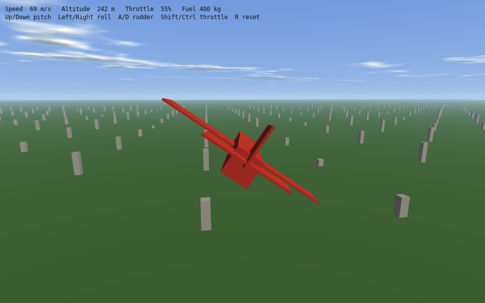

# Lesson 4 (simulation): Flight

[← Tutorial index](README.md) · Previous: [Weather](sim-03-weather.md)

**Goal:** fly a simple aircraft with real lift, drag, thrust and control surfaces, seen from a chase camera.



## The idea

- A `FlightWorld` simulates bodies in gravity and air. Here it is the simplest kind: a flat ground plane, uniform gravity and an atmosphere that thins with height.
- An aircraft is a `FlightBody` with a mass, tanks, **lifting surfaces** (wings, ailerons, elevator, rudder) and **thrusters**. You never code "lift"; it comes out of each surface's `area`, `cl_alpha` (how fast lift grows with angle) and position.
- Control surfaces are named: a surface with `control_name = "elevator"` responds to `world.set_control(id, "elevator", value)` with a value from -1 to 1. `control_gain` says how far it deflects.
- The body frame has the nose along **-Z**, wings along X and up along Y. A positive elevator pushes the nose down, a positive aileron rolls right and a positive rudder yaws left.
- `world.step(dt)` advances the simulation with the RK4 integrator in small substeps. You then read `position`, `velocity` and `orientation` back to draw.

## The program

```cpp
#include "sl.h"
#include "flight.h"

#include <algorithm>
#include <cmath>

namespace
{
    sl::LiftingSurface surface(const char *control, sl::dvec3 position, sl::dvec3 up, double area, double cl_alpha,
                               double cl0, double gain)
    {
        sl::LiftingSurface s;
        s.control_name = control;
        s.position = position;
        s.up = up;
        s.area = area;
        s.cl_alpha = cl_alpha;
        s.cl0 = cl0;
        s.control_gain = gain;
        return s;
    }

    // Put the aircraft back in the air, flying level at 70 m/s.
    void reset(sl::FlightBody &b)
    {
        b.position = {0.0, 250.0, 0.0};
        b.velocity = {0.0, 0.0, -70.0};
        b.orientation = {1.0, 0.0, 0.0, 0.0};
        b.angular_velocity = {0.0, 0.0, 0.0};
        b.thrusters[0].level = 0.55;
    }
}

int main(int argc, char *argv[])
{
    if (!sl::configure_graphics_backend_from_args(argc, argv) ||
        !sl::set_gfx_mode(sl::GFX_AUTODETECT_WINDOWED, 960, 600))
    {
        return -1;
    }
    sl::set_fps(60);
    sl::Surface3D *view = sl::create_surface_3d(960, 600, 4);
    sl::Mesh *cube = sl::create_cube_mesh(1.0f, {255, 255, 255, 255});
    if (!view || !cube)
        return -1;

    // 1. The world: gravity, a flat ground plane and thin air that gets thinner with height.
    sl::FlightWorld world;
    world.flat_ground = true;
    world.uniform_gravity = {0.0, -9.80665, 0.0};
    world.flat_atmosphere.surface_density = 1.225;
    world.integrator = sl::FlightIntegrator::rk4;
    world.max_substep = 0.01;

    // 2. The aircraft: a mass, an engine and lifting surfaces. Lift, drag and control forces all come from these numbers.
    const int id = world.create_body("aircraft");
    sl::FlightBody &plane = *world.body(id);
    plane.dry_mass = 1100.0;
    plane.dry_inertia = {2000.0, 2800.0, 1200.0}; // pitch, yaw, roll
    plane.tanks.push_back({400.0, 400.0});
    plane.drag_area = 0.45;
    plane.angular_damping = 150.0;
    plane.surfaces.push_back(surface("wing", {-2.5, 0.0, 0.0}, {0, 1, 0}, 8.0, 4.6, 0.3, 0.0));
    plane.surfaces.push_back(surface("wing", {2.5, 0.0, 0.0}, {0, 1, 0}, 8.0, 4.6, 0.3, 0.0));
    plane.surfaces.push_back(surface("aileron", {-4.5, 0.0, 0.0}, {0, 1, 0}, 1.4, 3.5, 0.0, 0.18));
    plane.surfaces.push_back(surface("aileron", {4.5, 0.0, 0.0}, {0, 1, 0}, 1.4, 3.5, 0.0, -0.18));
    plane.surfaces.push_back(surface("elevator", {0.0, 0.2, 5.0}, {0, 1, 0}, 3.5, 4.0, 0.0, 0.12));
    plane.surfaces.push_back(surface("rudder", {0.0, 0.9, 5.0}, {1, 0, 0}, 1.8, 3.0, 0.0, 0.2));
    sl::Thruster jet;
    jet.position = {0.0, 0.0, 1.0};
    jet.direction = {0.0, 0.0, -1.0}; // the aircraft's nose points along -Z
    jet.max_thrust = 4500.0;
    jet.isp = 3000.0;
    jet.tank = 0;
    jet.air_breathing = true;
    plane.thrusters.push_back(jet);
    world.build_standard_groups(id); // names for the standard control groups
    reset(plane);

    bool running = true;
    while (running)
    {
        sl::Event event;
        while (sl::poll_event(&event))
        {
            if (event.type() == sl::Event::Type::quit ||
                (event.type() == sl::Event::Type::key_down && event.key() == sl::Event::Key::escape))
                running = false;
            if (event.type() == sl::Event::Type::key_down && event.key() == sl::Event::Key::letter_r)
                reset(plane);
            sl::display_handle_event(event);
        }
        const double dt = std::min(0.05, sl::get_frame_time() / 1000.0);

        // 3. Controls are numbers from -1 to 1 for each named control, plus the throttle level of the engine.
        auto axis = [](sl::Key plus, sl::Key minus)
        { return (sl::key_down(plus) ? 1.0 : 0.0) - (sl::key_down(minus) ? 1.0 : 0.0); };
        double &throttle = plane.thrusters[0].level;
        if (sl::key_down(sl::Key::left_shift))
            throttle = std::min(1.0, throttle + 0.5 * dt);
        if (sl::key_down(sl::Key::left_control))
            throttle = std::max(0.0, throttle - 0.5 * dt);
        world.set_control(id, "elevator", axis(sl::Key::arrow_up, sl::Key::arrow_down));
        world.set_control(id, "aileron", axis(sl::Key::arrow_right, sl::Key::arrow_left));
        world.set_control(id, "rudder", axis(sl::Key::letter_a, sl::Key::letter_d));
        world.step(dt);

        // Read the state back: the body frame has the nose along -Z, so velocity in that frame is airspeed.
        const double airspeed = glm::length(plane.direction_to_local(plane.velocity));
        const glm::mat3 rot = glm::mat3_cast(glm::quat(plane.orientation));
        const glm::vec3 position = glm::vec3(plane.position);

        // A chase camera behind and above the aircraft that keeps the horizon level.
        const glm::vec3 forward = rot * glm::vec3(0.0f, 0.0f, -1.0f);
        const float heading = std::atan2(forward.x, -forward.z);
        const glm::mat3 yaw_only = glm::mat3(glm::rotate(glm::mat4(1.0f), -heading, glm::vec3(0.0f, 1.0f, 0.0f)));
        sl::Camera camera;
        camera.position = position + yaw_only * glm::vec3(0.0f, 3.0f, 14.0f);
        camera.target = position;
        camera.up = {0.0f, 1.0f, 0.0f};
        camera.field_of_view = 60.0f;
        camera.near_plane = 0.5f;
        camera.far_plane = 20000.0f;

        sl::Environment3D sky;
        sky.sun_direction = glm::normalize(glm::vec3(-0.4f, -0.6f, -0.5f));
        sky.up = {0.0f, 1.0f, 0.0f};
        sky.camera_position = camera.position;
        sky.camera_altitude = camera.position.y;
        sky.time = static_cast<double>(sl::time_ms()) * 0.001;
        sky.fog_enabled = true;
        sky.fog_density = 1.0e-4f;
        sky.clouds.enabled = true;

        if (sl::begin_surface_3d(view, camera))
        {
            sl::clear_surface_3d({150, 185, 230, 255});
            sl::set_environment_3d(sky);
            sl::draw_sky_3d();
            sl::Light3D sun;
            sun.direction = sky.sun_direction;
            sun.colour = sl::atmosphere_sun_colour(sky);
            sun.ambient = 0.35f;
            sl::set_light_3d(sun);

            // The ground and a grid of towers give a sense of speed.
            sl::Material grass;
            grass.tint = {70, 120, 60, 255};
            sl::draw_mesh(cube, glm::translate(glm::mat4(1.0f), {position.x, -1.0f, position.z}) *
                                    glm::scale(glm::mat4(1.0f), {30000.0f, 2.0f, 30000.0f}), grass);
            sl::Material stone;
            stone.tint = {190, 188, 180, 255};
            for (int gx = -12; gx <= 12; ++gx)
            {
                for (int gz = -12; gz <= 12; ++gz)
                {
                    const float x = std::floor(position.x / 400.0f) * 400.0f + gx * 400.0f;
                    const float z = std::floor(position.z / 400.0f) * 400.0f + gz * 400.0f;
                    const float h = 20.0f + 60.0f * std::fabs(std::sin(x * 0.013f + z * 0.007f));
                    sl::draw_mesh(cube, glm::translate(glm::mat4(1.0f), {x, h * 0.5f, z}) *
                                            glm::scale(glm::mat4(1.0f), {18.0f, h, 18.0f}), stone);
                }
            }

            // The aircraft is a few boxes, all positioned relative to the body's own frame.
            const glm::mat4 body = glm::translate(glm::mat4(1.0f), position) * glm::mat4(rot);
            sl::Material paint;
            paint.tint = {220, 60, 50, 255};
            sl::draw_mesh(cube, body * glm::scale(glm::mat4(1.0f), {1.2f, 1.2f, 9.0f}), paint);
            sl::draw_mesh(cube, body * glm::translate(glm::mat4(1.0f), {0.0f, 0.0f, -0.5f}) *
                                    glm::scale(glm::mat4(1.0f), {10.0f, 0.12f, 1.8f}), paint);
            sl::draw_mesh(cube, body * glm::translate(glm::mat4(1.0f), {0.0f, 0.3f, 4.5f}) *
                                    glm::scale(glm::mat4(1.0f), {3.8f, 0.1f, 1.2f}), paint);
            sl::draw_mesh(cube, body * glm::translate(glm::mat4(1.0f), {0.0f, 1.0f, 4.5f}) *
                                    glm::scale(glm::mat4(1.0f), {0.1f, 1.8f, 1.5f}), paint);
            sl::end_surface_3d();
        }

        sl::draw_sprite(sl::surface_3d_bitmap(view), 0.0f, 0.0f);
        sl::gprintf(10, 10, {20, 20, 20}, "Speed %3.0f m/s   Altitude %4.0f m   Throttle %3.0f%%   Fuel %3.0f kg",
                    airspeed, plane.position.y, throttle * 100.0, plane.tanks[0].mass);
        sl::gprintf(10, 26, {20, 20, 20}, "Up/Down pitch  Left/Right roll  A/D rudder  Shift/Ctrl throttle  R reset");
        sl::show_video_bitmap();
        sl::end_frame();
    }

    sl::wait_for_graphics();
    sl::clear_environment_3d();
    sl::destroy_mesh(cube);
    sl::destroy_surface_3d(view);
    return 0;
}
```

## What just happened

1. **The world** sets gravity, the ground and air density. The RK4 integrator and `max_substep` of 10 ms keep stiff forces stable even if a frame is slow.
2. **The aircraft** is data: wings produce lift (`cl0` is lift at zero angle, `cl_alpha` the slope), control surfaces have a `control_gain`, and the jet pushes along its `direction` while burning fuel from the tank.
3. **Controls** write named values with `set_control`; the throttle is the thruster's `level` from 0 to 1.
4. **`world.step(dt)`** applies gravity, aerodynamic forces, thrust and torques, and integrates position and orientation.
5. **Reading back** `position` and `orientation` lets you draw the boxes with `body = translate * rotation`. `direction_to_local` turns the world velocity into the aircraft's frame to get airspeed.
6. **The chase camera** follows only the aircraft's heading, so the horizon stays level when the aircraft rolls.

## Try it

1. Hold Shift to climb at full throttle, then release and see the aircraft settle into a glide.
2. Cut the throttle to 0 with Ctrl and see how long it glides.
3. Increase wing `area` from 8 to 12 for a slower, floatier aircraft.
4. Change `dry_mass` to 2000 and see what the same engine does.
5. Show the climb rate on the HUD: `plane.velocity.y`.
6. Press R after a crash to reset.

## Go further

- Example: [`exflight`](../examples/exflight.md). Guide: [Flight](../flight.md). API: [3D flight and orbital dynamics](../api_reference.md#3d-flight--orbital-dynamics-includeflighth) (planets, orbits, rockets and landing gear).
- Next track: [Shipping an app](app-01-packaging-and-backends.md).
